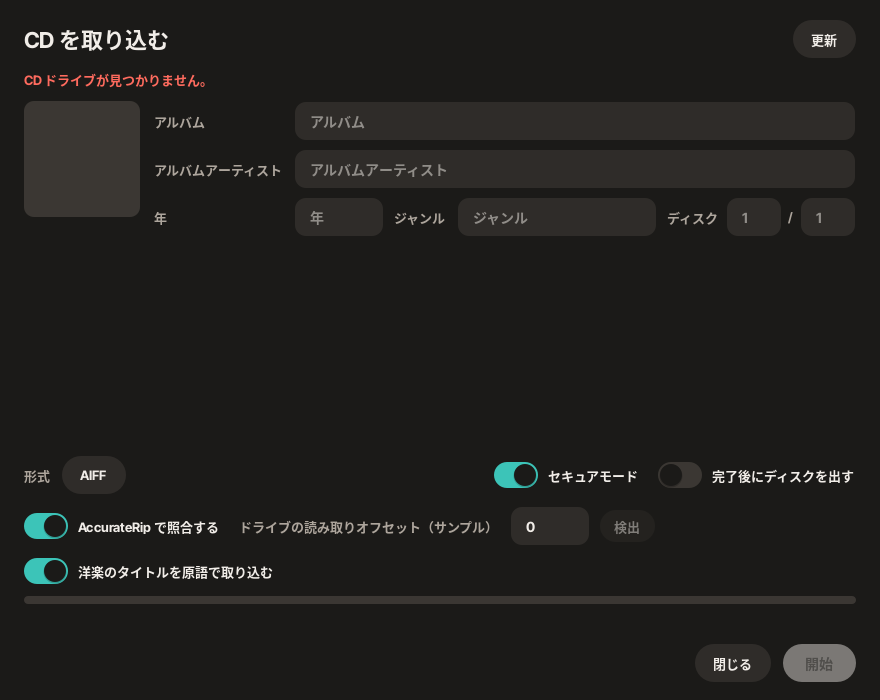
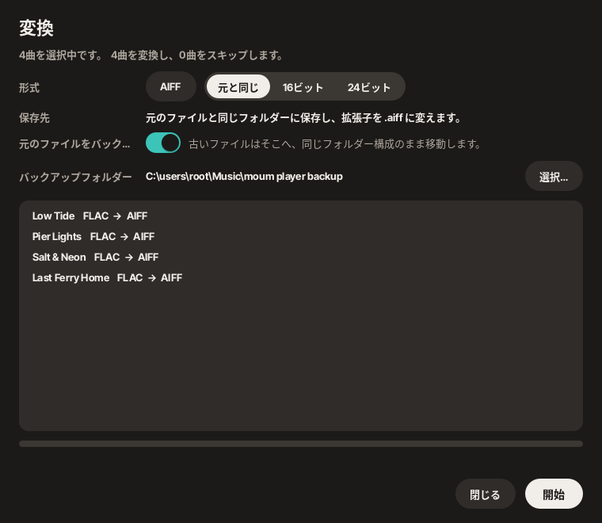
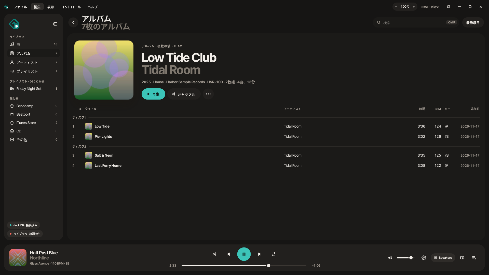
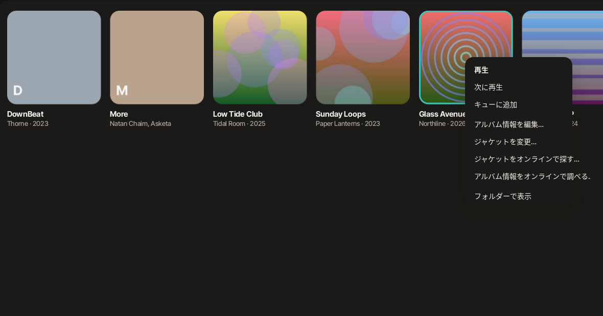

# moum player

**🏠 ホーム** ｜ [▶️ 基本の使い方](docs/basics.md) ｜ [🎵 曲の管理](docs/library.md) ｜ [💿 CD・変換・オンライン](docs/cd-convert-online.md) ｜ [💾 書き出しと設定](docs/export-settings.md) ｜ [❓ 困ったとき](docs/faq.md)

**手持ちの曲をきれいに並べて、すぐ再生できる音楽プレイヤー（Windows 用）。**

- 曲・アルバム・アーティスト・プレイリストで一覧して、ギャップレスで再生
- CD の取り込み、ファイルの変換、曲の情報（タグ）の編集、iTunes ライブラリの取り込み
- DJ ソフト [moum deck](https://github.com/mome0311/moum_deck) と一緒に使うと、さらに便利（単体でも使えます）

**[⬇ 最新のインストーラー（Releases）](../../releases/latest)**

## v1.1.0 の新機能

**💿 CD の取り込み**（ファイル › CD を取り込む…）
MusicBrainz で CD を特定して、曲名・アルバム名・ジャケットを自動で入れます。AccurateRip で、正確に取り込めたかも確かめられます。形式は AIFF（初期設定）・WAV・FLAC・ALAC・MP3・AAC。

**🔁 ファイルの変換**（編集 › 変換…）
選んだ曲を AIFF・WAV・FLAC・ALAC・MP3・AAC に変換します。元のファイルは、ライブラリの外にバックアップできます。

**🔎 アルバム情報・ジャケットをオンラインで調べ直す**
持っているアルバムを右クリックして、MusicBrainz・iTunes・Deezer の情報と見比べ、チェックした項目だけを反映します。より高画質なジャケットへの差し替えもできます。

**💽 2枚組のアルバム** と **🗂 サイドバーの新しい見た目**
アルバムはディスクごとに見出しが付いて並びます。サイドバーはアイコン付きになり、Ctrl B で細くたためます。購入元は自分で追加できます。画面はすべて日本語で表示されます。

| CD を取り込む | 変換 |
|---|---|
|  |  |

| 2枚組のアルバム | アルバムの右クリックメニュー |
|---|---|
|  |  |

## moum player ならではの機能

**① moum deck の解析結果をそのまま表示**
moum deck で解析した BPM・キーが曲の一覧に並び、キューポイントはシークバーに色付きの印で出ます。moum deck のプレイリストもサイドバーに出ます（読み取り専用）。

**② 買った記録を曲に残せる**
レーベル・カタログ番号に加えて、購入日・価格・購入元を記録できます。購入元は自分で追加でき、サイドバーで購入元ごとに絞り込めます。

**③ DJ ソフト用に書き出し**
moum deck 用の USB、この PC の moum deck、rekordbox XML、Traktor NML へ書き出せます。

**④ タグの書き込みやオンラインでの反映は元に戻せる**
曲の情報を直すと、音楽ファイルのタグにも書き込めます。あとから元に戻せます。

| ① moum deck のプレイリスト | ② 曲の情報を編集 |
|---|---|
|  |  |

## はじめかた

1. [Releases](../../releases/latest) からインストーラー（`moum_player-x.x.x-Setup.exe`）をダウンロードして実行
2. **ファイル › フォルダーを追加…**（Ctrl O）で音楽フォルダーを選ぶ（moum deck を使っている場合は、そのライブラリが自動で出ます）
3. 曲をダブルクリックして再生

対応形式は FLAC / MP3 / WAV / AIFF です。M4A（AAC / ALAC）の再生と、ALAC・AAC での取り込み・変換には ffmpeg が必要です。CD の取り込みには CD ドライブが必要です。

使い方の詳細は、ページ上部のリンクから開けます。

スクリーンショットは v1.1.0。写っている曲は撮影用のサンプルです。
