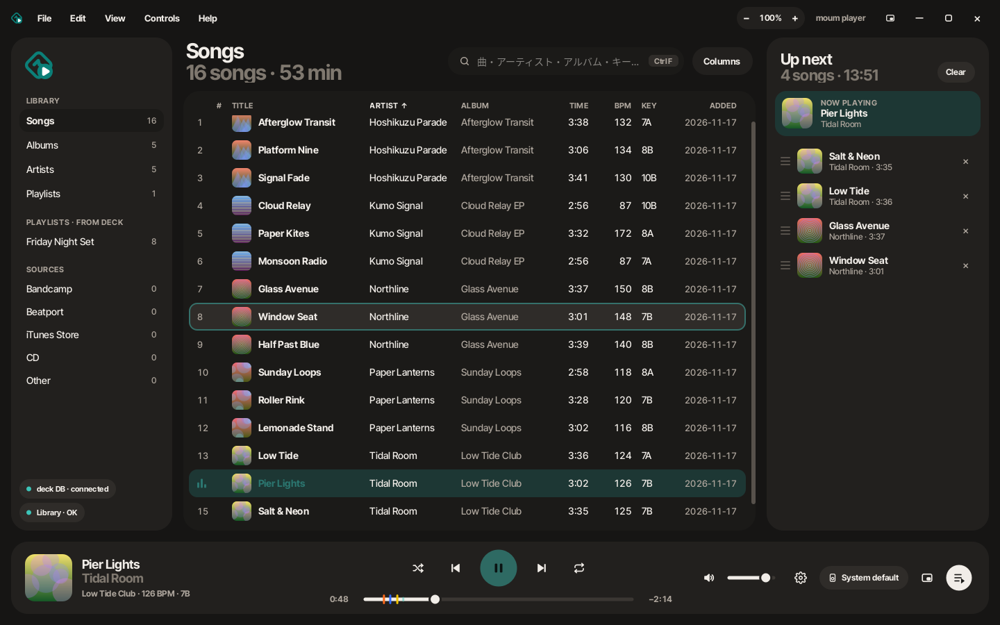
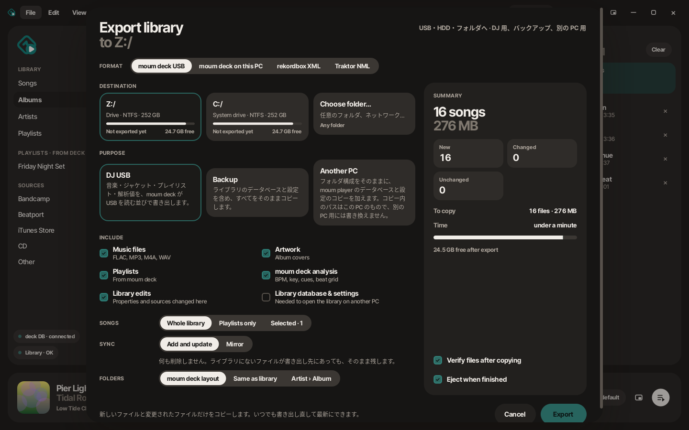
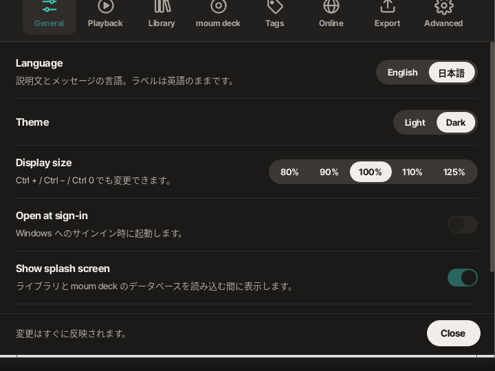
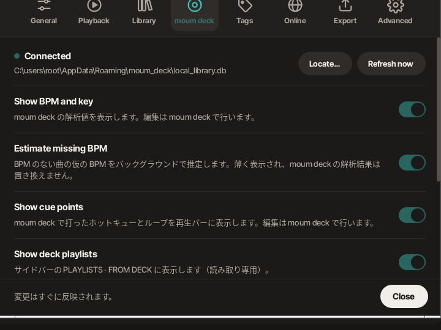

# moum player

**手持ちの曲をきれいに並べて、すぐ再生できる音楽プレイヤー（Windows 用）。**

曲・アルバム・アーティスト・プレイリストを一覧して、ギャップレスで再生できます。
曲の情報（タグ）の整理、iTunes ライブラリの取り込み、DJ ソフト用の書き出しもできます。

- DJ ソフト [moum deck](https://github.com/mome0311/moum_deck) と一緒に使うと、moum deck で解析した **BPM・キー・キューポイント・プレイリスト**が、そのまま見られます
- moum deck が無くても、曲の取り込み・再生・整理は使えます
- **[最新のインストーラーをダウンロード（Releases）](../../releases/latest)**

---

## できること

### 🎵 ライブラリを 4 つの見かたで

Songs（曲）/ Albums（アルバム）/ Artists（アーティスト）/ Playlists（プレイリスト）を、左のサイドバーで切り替えます。

| Albums | Artists |
|---|---|
|  |  |

アルバムを開くと、年・ジャンル・レーベル・カタログ番号と、中の曲が出ます。

### ▶️ 再生と再生キュー

ギャップレス再生、再生キュー（Up next）、シャッフル、リピート、出力デバイスの選択ができます。
moum deck で付けたキューポイントは、シークバーに色付きの印で出ます。小さなウィンドウで操作できるミニプレイヤーもあります（Ctrl M）。

### 🎧 moum deck のプレイリストをそのまま表示

moum deck で作ったプレイリストが、サイドバーの「PLAYLISTS · FROM DECK」に読み取り専用で出ます。

### ✏️ 曲の情報を編集

タイトルやアーティストに加えて、レーベル・カタログ番号・購入日・価格・購入元を記録できます。変更は音楽ファイルのタグにも書き込めます。

### 💾 DJ ソフト用に書き出し

moum deck 用の USB、この PC の moum deck、rekordbox XML、Traktor NML へ書き出せます。

### 🌗 ライト / ダーク

Ctrl D で切り替えます。

---

## はじめかた（3 ステップ）

1. **インストール**：[Releases](../../releases/latest) から最新のインストーラー（`moum_player-x.x.x-Setup.exe`）をダウンロードして実行します。
2. **曲を入れる**：moum deck を使っている人は、moum deck のライブラリが自動で一覧に出ます。使っていない人は、**File › Add folder…**（Ctrl O）で音楽フォルダーを選ぶか、フォルダーをウィンドウにドラッグ＆ドロップします。
3. **再生する**：曲をダブルクリックします。右クリックの **Play next** / **Add to queue** で、再生キューに追加できます。

M4A（AAC / ALAC）を再生する場合だけ、ffmpeg が必要です（[3. はじめかた](#3-はじめかた) の 3-3）。

---

## 詳しい使い方

ここから下は、機能ごとの詳しい説明です。GitHub Releases のインストーラーで moum player を入れた人向けに書いています。

- [1. 概要と主な機能](#1-概要と主な機能)
- [2. インストールと動作環境](#2-インストールと動作環境)
- [3. はじめかた](#3-はじめかた)
- [4. 画面と操作](#4-画面と操作)
- [5. 曲を取り込む](#5-曲を取り込む)
- [6. 曲の情報を編集する・ファイルのタグに書き込む](#6-曲の情報を編集するファイルのタグに書き込む)
- [7. 整理ツール](#7-整理ツール)
- [8. カバー画像・タグのオンライン検索](#8-カバー画像タグのオンライン検索)
- [9. ライブラリの健康診断](#9-ライブラリの健康診断)
- [10. 書き出し（Export）](#10-書き出しexport)
- [11. Settings（設定）](#11-settings設定)
- [12. データの場所とバックアップ](#12-データの場所とバックアップ)
- [13. キーボードショートカット](#13-キーボードショートカット)
- [14. トラブルシューティング・よくある質問](#14-トラブルシューティングよくある質問)
- [15. ライセンスとクレジット](#15-ライセンスとクレジット)

---

## 1. 概要と主な機能

- **ライブラリ表示**：Songs / Albums / Artists / Playlists の 4 つのビュー。検索と並べ替えができます。
- **再生**：ギャップレス再生、再生キュー（Up next）、シャッフル、リピート、出力デバイスの選択、ミニプレイヤー。
  moum deck で付けたキューポイントとループを、シークバーに表示できます。
- **取り込み**：フォルダー、ファイル、iTunes / Music の `Library.xml`。ドラッグ＆ドロップでも取り込めます。
- **曲情報の編集**：タイトル・アーティスト・アルバムなどに加えて、購入日・価格・レーベル・カタログ番号・購入元（Source）を記録できます。
  変更は、音楽ファイルのタグにも書き込めます（初期設定でオン。§6）。
- **整理ツール**：重複の検索、見つからないファイルの再リンク、アーティスト名の統一、ファイルの整理、文字化けしたタグの修復。
- **オンライン検索**：カバー画像と欠けているタグを探します（ボタンを押したときだけ通信します）。
- **健康診断**：ライブラリの問題を定期的に調べて知らせます（何も変更しません）。
- **書き出し**：moum deck 用の USB、この PC の moum deck、rekordbox XML、Traktor NML。
- **表示**：ライト / ダーク、English / 日本語、画面の拡大縮小。

対応する音声形式は、FLAC / MP3 / WAV / AIFF です。M4A（AAC / ALAC）は ffmpeg が必要です（§3-3）。
OGG はまだ再生できません。

### moum deck との関係

moum player は、moum deck のライブラリを**読むだけ**で使います。moum deck のデータは、基本的に書き換えません。
書き込むのは、次の限られた場面だけです。

| 場面 | 何を書くか | いつ |
|---|---|---|
| 取り込んだ曲のフォルダーを登録 | 取り込み先のフォルダーを、moum deck の「ライブラリの取り込み元」に追加します | 取り込みのとき（Settings › moum deck › Add imported folders to moum deck がオンの間。初期設定でオン） |
| タグの再読み込みの依頼 | 「このファイルのタグを読み直して」という依頼を残します | タグをファイルに書き込んだあと。moum deck が起動中でも行います |
| Export › moum deck on this PC | moum player で編集した内容を、moum deck のライブラリに反映します | あなたが実行したとき。**moum deck を閉じている間だけ**。先にバックアップを取ります（§10-2） |

BPM・キー・キューポイント・ビートグリッド・プレイリストは、moum player からは変更しません。それらの編集は moum deck で行います。

---

## 2. インストールと動作環境

- Windows のパソコン。
- このリポジトリの **Releases** から、最新のインストーラーをダウンロードして実行します。
- moum deck は**なくても**使えます。入れておくと、BPM・キー・キューポイント・プレイリストが見られます。
- M4A を再生・取り込みする場合だけ、ffmpeg が必要です（§3-3）。
- 新しいバージョンの自動確認は、今のバージョンにはありません（Settings › Online の「Check for updates」は、まだ使えません）。
  新しい版は、Releases のページから入れてください。設定とライブラリは、入れ直しても消えません（§12）。

---

## 3. はじめかた

### 3-1. 初めての起動とスプラッシュ

起動すると、スプラッシュ画面が出ます。次の順に進み、「Ready」でメイン画面に切り替わります。

1. ライブラリ（設定と moum player のデータ）を開く
2. moum deck のデータベースを読む
3. 曲の確認（編集内容を反映してライブラリを組み立てる）
4. カバー画像を読み込む（最初の画面の分だけ）

スプラッシュの下に、moum deck のデータベースの状態が出ます。

| 表示 | 意味 |
|---|---|
| MOUM DECK DB · CONNECTED | 読めています |
| MOUM DECK DB · NOT FOUND | 見つかりません（moum deck を使っていない場合は、そのままで問題ありません） |
| MOUM DECK DB · LOCKED | 一時的に読めません。しばらくすると自動で読み直します |

スプラッシュは **Settings › General › Show splash screen** でオフにできます。

### 3-2. 曲を入れる

- moum deck を使っている人：moum deck のライブラリが、自動で一覧に出ます。
- moum player で曲を入れる人：**File › Add folder…**（Ctrl O）、**File › Add files…**、**File › Import iTunes library…** を使います（§5）。
  フォルダーやファイルを、ウィンドウにドラッグ＆ドロップしても入れられます。

moum deck のデータベースが別の場所にあるときは、**Settings › moum deck › Locate deck DB** で選びます。

### 3-3. M4A（AAC / ALAC）には ffmpeg が必要

M4A の曲は、ffmpeg がないと再生できません（「再生できません」と表示されます）。

- 再生できない曲があると、お知らせに **Install ffmpeg** が出ます。**Settings › Library › ffmpeg › Install…** からも入れられます（Windows）。
- ボタンを押したときだけ、公開されているビルドをダウンロードし、チェックサムを確認して、`ffmpeg.exe` だけを moum player 専用の場所に置きます。
  ffmpeg は moum player に同梱していません。
- 自分で入れた ffmpeg を使うときは **Locate…** で選びます。
- moum deck が入れた ffmpeg が見つかれば、それも読むだけで使います。

---

## 4. 画面と操作

メニューバーは File / Edit / View / Controls / Help の 5 つです（Alt + 頭文字、または F10 で開けます）。

| メニュー | 項目 |
|---|---|
| File | Add folder… / Add files… / Import iTunes library… / Export library… / Show in folder / Settings… / Exit |
| Edit | Edit properties… / Find / Select all / Copy / Remove from library / Merge artist names… / Organise files… / Write tags to files… / Undo tag writes… / Find duplicates… / Find missing files… / Find missing covers… / Complete missing tags… |
| View | Songs / Albums / Artists / Playlists / Show queue / Dark mode / Zoom in / Zoom out / Actual size / Mini player |
| Controls | Play（再生中は Pause）/ Next / Previous / Shuffle / Repeat off・all・one / Volume up / Volume down |
| Help | Keyboard shortcuts / Third-party notices / Copy last startup timings / Open startup log folder / About moum player |

メニューやボタンの名前は、日本語表示にしても英語のままです（§4-7）。

### 4-1. ライブラリの 4 つのビュー

- **Songs**：曲の一覧。列は TITLE / ARTIST / ALBUM / TIME / BPM / KEY / SOURCE / ADDED / LABEL / CAT# / PURCHASED / PRICE。
  表示する列は、列の選択（Columns）で変えられます。
- **Albums**：アルバムの一覧（グリッド表示とリスト表示）。開くと、アルバムの中の曲が出ます。
- **Artists**：アーティストの一覧。開くと、そのアーティストの曲が出ます。
- **Playlists**：moum deck のプレイリストが、読み取り専用で出ます。**Settings › moum deck › Show deck playlists** で表示をオフにできます。

切り替えは、左のサイドバーか、**View** メニュー（Ctrl 1〜4）です。サイドバーでは、購入元（Source）ごとに絞り込めます。

### 4-2. 検索と並べ替え

- **検索**：Ctrl F で検索欄に移動します。タイトル・アーティスト・アルバム・キー・レーベル・カタログ番号が対象です。
- **曲の並べ替え**：列の見出し（TITLE / ARTIST / ALBUM / TIME / BPM / KEY / SOURCE / ADDED など）をクリックすると、昇順・降順が切り替わります。
  並べ方は、次の起動でも保たれます。
- **アルバムの並べ替え**：Albums ビューの並べ替えボタンから、**Newest first**（新しい順）/ **Oldest first**（古い順）/ **Name (A–Z)** を選びます。
  新しい・古いは、アルバムの曲の追加日で決まります。

### 4-3. アルバムのアーティスト表示

アルバムに表示するアーティスト名は、表示のためだけに、次の順で決めます（ファイルや moum deck には書きません）。

1. 曲に「アルバムアーティスト」があれば、それ。
2. なければ、過半数の曲が同じ名前のとき、その名前。
3. それもなければ、「feat. …」や「&」「,」などの手前の、主なアーティスト名が過半数のとき、その名前。
4. それでも決まらないときは **Various Artists**。

### 4-4. 再生

- **再生・一時停止**：Space。**前後の曲**：Ctrl → / Ctrl ←。**シーク**：← / →（5 秒ずつ）。**音量**：Ctrl ↑ / Ctrl ↓。
- **ギャップレス**：同じアルバムの曲が続くとき、曲の間に無音を入れません（次の曲を先に読み込みます）。
  **Settings › Playback › Gapless playback** でオフにできます。
- **再生キュー**：曲を右クリックして **Play next**（次に再生）/ **Add to queue**（キューの最後に追加）。
  **Show queue**（Ctrl Q）で、Up next を表示します。ウィンドウが狭いと、キューは自動で隠れます。
- **シャッフル / リピート**：Controls メニューか、プレーヤーのボタン。リピートは Off / All / One。
- **出力デバイス**：プレーヤーの出力ボタン、または **Settings › Playback › Output device** で選びます（System default もあります）。
  出力デバイスのサンプルレートに合わせて、自動で変換して再生します。
- **ミニプレイヤー**：**View › Mini player**（Ctrl M）。小さなウィンドウで、再生・前後・シャッフル・リピート・音量を操作できます。
  ピンで最前面に固定できます。フルウィンドウに戻すボタンもあります。
- **前回の続きから**：次に起動したとき、同じ曲・位置・キューで再開します（**Settings › Playback › Resume where I left off**。初期設定でオン）。
- **キューポイントとループ**：moum deck で付けたホットキューとループが、シークバーに表示されます（**Settings › moum deck › Show cue points**）。
  表示だけで、moum player では編集できません。
- **BPM とキー**：moum deck の解析結果を表示します（**Show BPM and key**）。
  moum deck の解析がない曲は、**Estimate missing BPM** がオンなら、仮の BPM をバックグラウンドで推定して、薄い色で表示します。moum deck の解析は上書きしません。

### 4-5. 曲の右クリックメニュー

- 曲：Play / Play next / Add to queue / Go to album / Go to artist / Edit properties… / Fix garbled tags… / Complete missing tags… / Show in folder
- アルバム：Play / Play next / Add to queue / Edit album info… / Change artwork… / Find cover online… / Show in folder
- アーティスト：Play / Play next / Add to queue / Go to artist

その場で使えない項目は、メニューに出ません。

### 4-6. ライブラリから外す

曲を選んで **Edit › Remove from library**（Del）を押すと、その曲が moum player の一覧から隠れます。
**ファイルも moum deck のデータも、そのままです。** 画面下の「Undo」で戻せます。

### 4-7. 表示の設定

- **Dark mode**：Ctrl D。
- **表示サイズ**：Ctrl + / Ctrl − / Ctrl 0（Settings › General › Display size）。画面に収まらないときは小さくします。
- **Language**：English / 日本語。日本語にするのは説明文とメッセージだけで、メニュー・ボタン・見出しなどの短い名前は英語のままです。

---

## 5. 曲を取り込む

### 5-1. フォルダー・ファイルを取り込む

1. **File › Add folder…**（Ctrl O）でフォルダーを、**File › Add files…** でファイルを選びます。ウィンドウへのドラッグ＆ドロップでも始められます。
2. 曲を調べる画面になります（再生は続けられます）。調べ終わると、確認の画面が出ます。
3. 確認の画面で、次を決めて **Import** を押します。

| 項目 | 内容 |
|---|---|
| Save to (library folder) | 曲のコピー先。初期値は、ミュージックフォルダー内の `moum player` です。**Change…** で変えられます |
| Folder layout | コピー先でのファイル名の付け方。`Artist / Album / 01 Title`、`Artist / Album / Title`、`Artist - Album / 01 Title` から選びます |
| Duplicates | 重複していた曲を **Skip**（取り込まない）か **Import** にします（重複の見つけ方は下記） |
| Garbled tags | 文字化けして見えるタグを直して取り込みます（直した内容は moum player に保存され、ファイルは変えません） |
| Add to moum deck | 取り込み先のフォルダーを、moum deck の取り込み元に追加します（§1） |

- **取り込んだ曲は、いつも「ライブラリフォルダー」にコピーされます。元のファイルは変更しません。**
- 取り込めなかったファイル（ffmpeg がない M4A、取り込まない種類、読めないファイル）は、確認の画面の「NOT IMPORTED」に出ます。
- 重複は、次の 3 つで見つけます：すでにライブラリにある / 内容が同一 / タイトル・アーティスト・アルバム・長さが同じ。
- 途中で Cancel しても、取り込み済みの曲は残ります（途中のコピーは消えます）。
- 取り込む種類は **Settings › Library › File types** で選べます（FLAC / MP3 / M4A / WAV / AIFF。M4A は ffmpeg が必要。OGG は選べません）。
- moum deck が起動中でデータベースが使えないときは、フォルダーの登録が「待ち」になり、あとで自動で再試行します。
  **Settings › moum deck** の **Retry now** で、すぐにやり直せます。

### 5-2. iTunes / Music ライブラリを取り込む

1. iTunes（または Music）で、ライブラリを書き出して `Library.xml` を作ります（iTunes: ファイル › ライブラリ › ライブラリを書き出す…）。
2. **File › Import iTunes library…** で、その XML ファイルを選びます。
3. あとは §5-1 と同じ確認の画面です。曲のファイルが見つからないものは、「NOT IMPORTED」に数が出ます。

XML ファイルは読むだけで、変更しません。曲は、ライブラリフォルダーにコピーされます。

### 5-3. 以前の「その場のまま」の曲

以前の版で、コピーせずに追加した曲は、元の場所のまま再生されます。
**Settings › Library › Songs outside the library folder** に、そのフォルダーが出ます。
フォルダーの右の × で、そのフォルダーの曲を moum player から外せます（**ファイルは消えません**）。

### 5-4. ライブラリの読み直し

- **Settings › Library › Rescan now**：ライブラリの曲を、もう一度調べます。
- **Ctrl R**（Refresh library）：moum deck のデータを読み直します。
- moum deck が更新されたときは、数秒以内に自動で読み直されます（**Settings › moum deck › Refresh when moum deck closes**）。

---

## 6. 曲の情報を編集する・ファイルのタグに書き込む

### 6-1. 曲の情報を編集する

曲を選んで **Edit › Edit properties…**（Ctrl I）、または右クリックの **Edit properties…**。
アルバムごとは **Edit album info…**、複数の曲を選んだときは、共通の項目をまとめて変えられます
（曲によって違う項目は「Mixed」と出て、空のままなら変わりません）。

| 項目 | 内容 |
|---|---|
| Title / Artist / Album artist / Album / Genre / Track # / Year | 基本の情報 |
| Label / Catalog # | レーベルとカタログ番号 |
| Purchased / Price | 購入日（例：2024-03-05）と価格（例：¥1,500 / $9.99）。**moum player の中だけに保存され、ファイルにも moum deck にも書きません** |
| Source | 購入元。Bandcamp / Beatport / iTunes Store / CD / Other から選びます（もう一度押すと解除） |

- アルバムの **Change artwork…** で、カバー画像（JPEG / PNG）を差し替えられます。**Remove** で、ファイルのカバーに戻ります。
- BPM とキーは moum deck の解析結果で、ここでは変えられません。
- 文字化けして見えるタグがあると、修復案が出ます。**Use suggestions** で入力欄に入れられます。
- 編集内容は、まず moum player のデータ（`player.db`）に保存されます。**moum deck は変わりません。**

### 6-2. ファイルのタグに書き込む（初期設定でオン）

**この機能は、初期設定でオンです。** 編集画面の「Also write tags to file」にチェックが入った状態で始まり、Save を押すと、
音楽ファイルの中のタグ（タイトル・アーティスト・アルバム・ジャンル・年・トラック番号・カバーなど）も書き換えます。
こうすると、iTunes など他のプレーヤーでも、同じ情報が見えます。

- **ファイルそのものを書き換えます。** 書き換えたくないときは、編集画面で「Also write tags to file」のチェックを外します。
  チェックの状態は覚えられます。**Settings › Tags › Write changes into the music files** でも、オン・オフできます。
- 書き込む前の古い値は、`tag_write_log.jsonl`（moum player のデータフォルダー内）に残ります。
  元に戻したいときは、**Edit › Undo tag writes…**（§6-4）。
- moum deck のデータベースは、このとき変わりません。

### 6-3. まとめて書き込む：Edit › Write tags to files…

moum player が表示している内容（編集を含む）と、ファイルのタグが**違う曲だけ**を調べて、一覧にします。

1. **Edit › Write tags to files…** を開く（Settings › Tags › Write tags to files の **Preview…** でも同じ）。
2. 違いのある曲と、変わる項目（例：`Title: 旧 → 新`）が出ます。書き込まない曲は、チェックを外します。
3. **Write** を押すと、書き込みが始まります。途中で止めることもできます。
4. 結果（書き込んだ・すでに同じ・失敗）が出ます。

書き込む項目は、Title / Artist / Album artist / Album / Genre / Year / Track # / Disc # / BPM / Key / Label / Catalog # / Compilation / Cover です。
**購入日・価格・購入元は、ファイルに書きません。**
書き込めるファイルは、MP3 / AIFF / WAV / FLAC / M4A などです。

moum deck の曲にタグを書き込んだときは、moum deck に「このファイルのタグを読み直して」という依頼を残します（moum deck が起動中でも行います）。
moum deck は、手が空いたときに、タグ由来の項目だけを読み直します（BPM・キー・キュー・ループ・グリッドは変わりません）。
古い版の moum deck では、この依頼は残されません。

### 6-4. 元に戻す：Edit › Undo tag writes…

1. **Edit › Undo tag writes…** を開くと、最近の書き込みが、新しい順に並びます（記録は約 180 日分）。
2. 戻したい回を選ぶと、何が戻るかのプレビューが出ます。
3. **Restore** で戻します。

- ファイルのタグが、moum player が書いたときのままの曲だけが戻ります。**その後に変更された曲や、移動・削除された曲は、スキップされます。**
- その書き込みで変わった moum player 側の値（編集内容・差し替えたカバー）も、あなたがその後に変えていなければ、一緒に戻ります。

---

## 7. 整理ツール

いずれも、**Edit** メニューか **Settings › Tags** から開けます。実行の前にプレビューが出ます。

| ツール | 開く場所 | 内容 |
|---|---|---|
| 重複 | Edit › Find duplicates… | ライブラリに何度も入っている曲を見つけて、余分なコピーを隠します |
| 見つからないファイル | Edit › Find missing files… | 移動・名前変更でファイルが見つからなくなった曲の、新しい場所を探して付け替えます（再リンク） |
| アーティスト名の統一 | Edit › Merge artist names… | 大文字小文字・全角文字・スペース・「The」だけが違うアーティスト名を、1 つの書き方にそろえます |
| ファイルの整理 | Edit › Organise files… | moum player が取り込んだ曲を、タグに合わせて、ライブラリフォルダーの中で移動します（フォルダーの付け方は Settings › Library › Folder layout）。空になったフォルダーは消えます |
| 文字化けしたタグの修復 | 右クリック › Fix garbled tags…、Settings › Tags › Find garbled | 文字コードの取り違いで化けた日本語のタグを探して、直します |
| 欠けているタグの補完 | Edit › Complete missing tags… | タグが空の曲に、ファイル名などから、タイトル・アーティスト・アルバム・年・トラック番号の案を出します |

- アーティスト名の統一と、ファイルの整理は、実行したあとに「Undo」が出ます。
- 移動したファイルは、上書きされません。**moum deck の曲は、Organise files では移動しません。**
- アーティスト名の統一では、「Also write the name into the music files」で、ファイルのタグにも書き込めます（moum player が取り込んだ曲が対象です）。
- これらの変更は moum player に保存され、moum deck は変わりません。moum deck にも反映したいときは、§10-2 を使います。

---

## 8. カバー画像・タグのオンライン検索

- **Edit › Find missing covers…**：カバー画像のないアルバムを一覧して、オンラインで探します。
- **Edit › Complete missing tags…**：欠けているタグを、ファイル名から推測します。オンラインでも探せます。

**ボタン（Look up）を押したときだけ**、インターネットに接続します。送るのは、アルバム名・アーティスト名・曲名だけです。
接続先は、iTunes Search API と、MusicBrainz / Cover Art Archive です。
**Settings › Online › Look up covers and tags online** をオフにすると、オンライン検索は使いません。

見つけたカバーやタグは、まず moum player に保存されます。ファイルのタグへの書き込みは、画面でチェックしたときだけです。
moum deck は変わりません。

---

## 9. ライブラリの健康診断

起動の少しあとと、その後は 1 日に 1 回、ライブラリを調べます。**何も変更しません。**
サイドバーの下に、結果が **Library · OK** または **Library · 3 to check** のように出ます。クリックすると、一覧が開きます。

調べる項目：見つからないファイル / 重複 / 文字化けしたタグ / 表記ゆれのアーティスト名 / カバーのないアルバム。
項目ごとの **Open…** で、対応する整理ツール（§7、§8）が開きます。**Check now** で、すぐに調べ直せます。

**Settings › Tags › Check the library regularly** で、定期チェックをオフにできます。

---

## 10. 書き出し（Export）

**File › Export library…**（Ctrl E）を開きます。上の **FORMAT** で、書き出し先の種類を選びます。

### 10-1. moum deck USB

USB メモリや外付けドライブに、曲・カバー画像・moum deck 用のライブラリ（ドライブの一番上の `.moum_deck` フォルダー）を書き出します。
moum deck は、USB のライブラリを、**ドライブの一番上のフォルダー**からだけ探します。

| 項目 | 内容 |
|---|---|
| DESTINATION | 書き出し先のドライブ、または **Choose folder…** で選ぶフォルダー |
| PURPOSE | **DJ USB**（曲・カバー・プレイリスト・解析を moum deck の並びで）/ **Backup**（ライブラリのデータベースと設定も含めて、そのままコピー）/ **Another PC**（フォルダーの並びと、moum player のデータベースと設定のコピー。中のパスは元の PC のもので、書き換えません） |
| INCLUDE | Music files / Artwork / Playlists / moum deck analysis / Library edits / Library database & settings |
| SONGS | Whole library / Playlists only / Sources / Selected songs |
| SYNC | **Add and update**（何も消さない）/ **Mirror**（以前この書き出しで入れて、今は選ばれていない曲を消す。ほかのファイルは残る） |
| FOLDERS | moum deck layout / Same as library / Artist › Album |

- 右の SUMMARY に、New（新規）/ Changed（変更）/ Unchanged（変更なし）の数、コピーするサイズ、空き容量が出ます。
  **新しい・変わったファイルだけ**をコピーするので、何度でも同じドライブに書き出し直せます。
- 空き容量が足りないときや、ドライブの一番上ではないフォルダーを選んだときは、警告が出ます（その場合 moum deck は USB のライブラリを見つけません）。
- 書き出し中も、再生は続けられます。**ドライブを抜かないでください。** Cancel export で止められます。
- exFAT のドライブは、Windows と Mac の moum deck で使えます。

### 10-2. moum deck on this PC

moum player で編集した内容を、**この PC の moum deck のライブラリ**に書き込みます。moum deck で、同じ情報が見えるようになります。

1. 先に **moum deck を終了**します。起動中は、何も書き込まれません。
2. **FORMAT** で「moum deck on this PC」を選びます。変更される曲と項目の**プレビュー**が出ます。
3. 確認して実行します。**書き込む前に、データベースのバックアップ**（zip ファイル）を、moum deck のデータベースと同じ場所に作ります（新しい 5 つを残します）。
4. 次に moum deck を起動すると、新しい値が読まれます。

- 書き込む項目：タイトル・アーティスト・アルバム・アルバムアーティスト・ジャンル・年・トラック番号・レーベル・カタログ番号・追加日。
  （古い版の moum deck では、アルバムアーティスト・レーベル・カタログ番号などが書き込めません。）
- **BPM・キー・キュー・ループ・グリッド・プレイリストは変わりません。**
- moum player で、ファイルを移動（再リンクや整理）した曲は、moum deck でも新しいパスに付け替えられます。キューやプレイリストは、そのまま残ります。
  移動先に、すでに別の曲がある場合は、付け替えず、一覧に出ます。
- 書き込みは、1 回の処理で行います。途中で止まったときは、変更されません。
- 戻したいときは、作られたバックアップを使います。

### 10-3. rekordbox XML

rekordbox 用の XML ファイルを 1 つ書き出します。曲のファイルはコピーせず、今の場所を指します。キューとループは、moum deck の解析から作られます。

- rekordbox 側：Preferences › Advanced › Database › rekordbox xml でこのファイルを選び、ツリーの「rekordbox xml」から、曲やプレイリストを取り込みます。

### 10-4. Traktor NML

Traktor 用のコレクションファイル（`.nml`）を 1 つ書き出します。曲のファイルはコピーしません。

- Traktor 側：Browser Tree の「Track Collection」を右クリック › Import Another Collection で、このファイルを選びます。Traktor 自身のコレクションは、置き換わりません。

rekordbox XML と Traktor NML では、書き出し先のファイルを選びます。もう一度書き出すと、その時点のライブラリで、ファイルが置き換わります。
どちらも、他のソフトのデータは変更しません。

---

## 11. Settings（設定）

**File › Settings…**（Ctrl ,）で、別ウィンドウの設定が開きます。上のタブで切り替えます。
**変更はすぐ反映・保存されます**（OK ボタンはありません）。閉じるのは Close か Esc です。

| General タブ | moum deck タブ |
|---|---|
|  |  |

| タブ | 内容 |
|---|---|
| General | Language / Theme（Light・Dark）/ Display size / Show splash screen。（Open at sign-in、Close button の「Keep playing in tray」は、まだ使えません） |
| Playback | Output device / Gapless playback / Resume where I left off。（Exclusive mode、Crossfade、Volume levelling は、まだ使えません） |
| Library | Library folder（Change… / Open）/ Folder layout / Add music（Add folder… / Add files…）/ iTunes / Music library（Import…）/ Songs outside the library folder / moum deck folders（参考表示）/ Rescan now / File types / ffmpeg（Install… / Locate…）。（Watch folders は、まだ使えません） |
| moum deck | moum deck のデータベースの状態（Locate deck DB / Refresh now）/ Show BPM and key / Estimate missing BPM / Show cue points / Show deck playlists / Refresh when moum deck closes / Add imported folders to moum deck（Retry now） |
| Tags | Garbled tags / Artist names / Organise files / Duplicates / Missing files / Check the library regularly（Check now）/ Missing tags / Write changes into the music files / Write tags to files |
| Online | Look up covers and tags online / Covers。（Check for updates は、まだ使えません） |
| Export | Export now…。（そのほかの項目は準備中です） |
| Advanced | Keyboard（ショートカットの一覧）/ Licences（Third-party notices） |

「まだ使えません」と書いた項目は、画面には出ますが、押せません（今のバージョンでは未対応）。

---

## 12. データの場所とバックアップ

### moum player のデータ

`%APPDATA%\moum_player\` に保存されます。インストール先には書きません。アップデートや再インストールでは消えません。

| ファイル | 内容 |
|---|---|
| `settings.json` | 設定 |
| `player.db` | moum player のデータ（編集内容、購入元・購入日・価格、取り込んだ曲、再生位置など） |
| `tag_write_log.jsonl` | ファイルのタグへ書き込む前の値の記録（Undo tag writes で使います） |
| `startup_log.jsonl` | 起動時間の記録（直近 30 回分。§14） |
| `ffmpeg\` | moum player が入れた ffmpeg（入れた場合のみ） |

- `player.db` が壊れていたときは、新しいものを作り直して起動します。古いファイルは、別の名前で残します（画面にもお知らせが出ます）。
- `player.db` が新しい版の moum player で保存されたものだったときは、表示だけで、変更は保存できません。moum player を新しくしてください。

### 曲のファイル

取り込んだ曲は、Library folder（初期値はミュージックフォルダー内の `moum player`）に入っています。
moum deck のライブラリの曲は、moum deck が読む元のフォルダーにあります。

### バックアップの取り方

- **moum player を終了してから**、`%APPDATA%\moum_player\` フォルダーを、フォルダーごとコピーします。
- 曲のファイルは、別にコピーしておいてください。
- 曲のファイルとデータをまとめて残したいときは、**Export › moum deck USB** の **Backup**（Library database & settings を含む）が使えます（§10-1）。
- moum deck のデータ（`%APPDATA%\moum_deck\`）は moum deck 側のデータです。moum deck を終了してから、フォルダーごとコピーしてください。
- **Export › moum deck on this PC** は、実行のたびに、moum deck のデータベースのバックアップ（zip）を作ります（§10-2）。

---

## 13. キーボードショートカット

アプリの **Help › Keyboard shortcuts**（F1）と、同じ内容です。

| キー | 動作 |
|---|---|
| Space | 再生 / 一時停止 |
| ← / → | 5 秒戻る / 5 秒進む |
| ↑ / ↓ | 曲の選択 |
| Enter | 選んだ曲を再生 |
| Ctrl F | 検索 |
| Ctrl I | Edit properties（曲の編集） |
| Ctrl E | Export library（書き出し） |
| Ctrl , | Settings |
| Ctrl M | ミニプレイヤー |
| Ctrl 1〜4 | Songs / Albums / Artists / Playlists |
| Ctrl Q | 再生キュー（Up next）の表示 |
| Ctrl D | ダークモード |
| Ctrl + / Ctrl − / Ctrl 0 | 表示サイズの拡大 / 縮小 / 100% |
| Ctrl → / Ctrl ← | 次の曲 / 前の曲 |
| Ctrl S | シャッフル |
| Ctrl ↑ / Ctrl ↓ | 音量 |
| F1 | Keyboard shortcuts |
| Alt / F10 | メニューバー（Alt + F / E / V / C / H で、各メニュー） |

メニューにだけ出るショートカット：Ctrl O（Add folder…）、Ctrl A（Select all）、Ctrl C（Copy）、Ctrl R（Refresh library）、Del（Remove from library）。

---

## 14. トラブルシューティング・よくある質問

**moum deck の曲が出ない / 「NOT FOUND」と出る**
moum deck を使っていない場合は、そのままで問題ありません。moum deck を使っている場合は、**Settings › moum deck › Locate deck DB** で、`local_library.db` を選んでください。

**「LOCKED」と出る / 一覧が更新されない**
moum deck がデータベースを使っている最中は、一時的に読めないことがあります。前の一覧が表示されたままになり、しばらくすると自動で読み直されます。**Refresh now** でも読み直せます。

**M4A の曲が再生できない・取り込めない**
ffmpeg が必要です。Settings › Library › ffmpeg の **Install…**（または再生できない曲のお知らせの **Install ffmpeg**）で入れてください。入れたあと、取り込みをやり直してください。

**取り込んだ曲が moum deck に出ない**
- Settings › moum deck › **Add imported folders to moum deck** がオンか、確認してください。
- 「N folders wait to be added」と出ているときは、**Retry now** を押してください。moum deck が起動中で、データベースが使えなかった可能性があります。
- 古い版の moum deck は、取り込み元の登録に対応していないことがあります。moum deck 側で、フォルダーを追加してください。

**ファイルのタグを書き換えたくない**
編集画面の「Also write tags to file」のチェックを外してください（Settings › Tags › Write changes into the music files も同じ設定です）。
すでに書き込んだ分は、**Edit › Undo tag writes…** で戻せます。

**タグを書き込んだのに、moum deck の表示が変わらない**
moum deck が、手が空いたときに読み直します。しばらく待つか、moum deck を起動し直してください。古い版の moum deck では、読み直しの依頼が残されません。

**Export › moum deck on this PC が実行できない**
moum deck を終了してから、もう一度実行してください。起動中は、何も書き込まれません。

**moum deck USB の書き出しで、曲が一部コピーされない**
書き出し後の結果に「N files could not be copied」と出たら、ログを確認してください。元のファイルが見つからないときは、「N files were not found and are skipped」と出ます。

**起動が遅い**
Help の **Copy last startup timings** で、直近の起動時間をコピーできます。問題の連絡のときに、貼り付けて送ってください。
**Open startup log folder** で、記録ファイル（`startup_log.jsonl`）のフォルダーが開きます。
記録に入るのは、時間とバージョンの数字だけです。曲名やファイルの場所は入りません。直近 30 回分が残ります。

**スプラッシュを出したくない**
Settings › General › Show splash screen をオフにしてください。

**画面が大きすぎる・小さすぎる**
Ctrl + / Ctrl − / Ctrl 0、または Settings › General › Display size で変えてください。

**メディアキー（キーボードの再生・停止キー）**
対応していますが、実機での確認は十分ではありません。動かないときは、画面のボタンを使ってください。

**新しい版が出たか知りたい**
今のバージョンには、自動確認はありません。Releases のページで確認してください。

---

## 15. ライセンスとクレジット

- moum player は、GNU GPL バージョン 3 以降のフリーソフトウェアです。ライセンスの全文は、同梱の `LICENSE` にあります。
- 使っている第三者のソフトウェアとライセンスは、`THIRD_PARTY_NOTICE.md` にまとめています。アプリの **Help › Third-party notices** からも見られます。
  - Inter Tight フォント（SIL Open Font License 1.1）は、アプリに同梱しています。
  - ffmpeg は、同梱も再配布もしていません。あなたが Install ffmpeg を押したときだけ、公開されているビルドを取得します。
- Traktor は Native Instruments GmbH、rekordbox は AlphaTheta Corporation の商標です。
  moum player は、これらの企業とは関係のない、独立したソフトウェアです。

---

スクリーンショットは v1.0.1 のものです。画面に写っている曲は、撮影用に作ったサンプルです。
