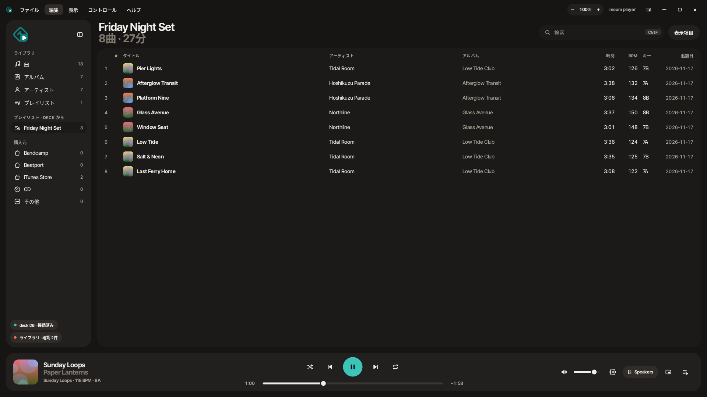
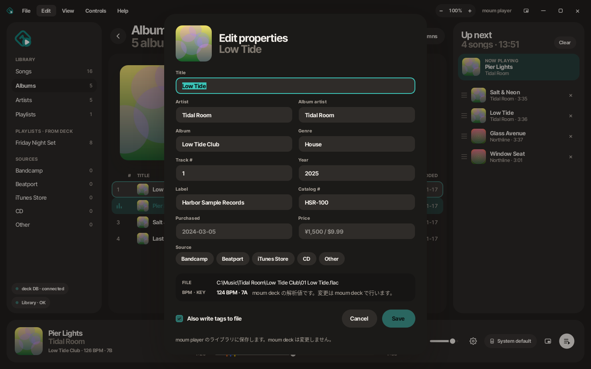

# moum player

**手持ちの曲をきれいに並べて、すぐ再生できる音楽プレイヤー（Windows 用）。**

- 曲・アルバム・アーティスト・プレイリストで一覧して、ギャップレスで再生
- 曲の情報（タグ）の編集、iTunes ライブラリの取り込み
- DJ ソフト [moum deck](https://github.com/mome0311/moum_deck) で解析した **BPM・キー・キューポイント・プレイリスト**をそのまま表示
- moum deck USB / rekordbox XML / Traktor NML への書き出し

**[⬇ 最新のインストーラー（Releases）](../../releases/latest)**　・　**[📖 詳しい使い方](docs/guide.md)**

## 画面

| アルバム | moum deck のプレイリスト |
|---|---|
|  |  |

| 曲の情報を編集 | 書き出し |
|---|---|
|  |  |

## はじめかた

1. [Releases](../../releases/latest) からインストーラー（`moum_player-x.x.x-Setup.exe`）をダウンロードして実行
2. **File › Add folder…**（Ctrl O）で音楽フォルダーを選ぶ（moum deck を使っている場合は、そのライブラリが自動で出ます）
3. 曲をダブルクリックして再生

対応形式は FLAC / MP3 / WAV / AIFF です。M4A（AAC / ALAC）だけ ffmpeg が必要です。

取り込み・タグの書き込み・書き出し・設定・トラブル対処は、[詳しい使い方](docs/guide.md) にまとめています。

スクリーンショットは v1.0.1。写っている曲は撮影用のサンプルです。
