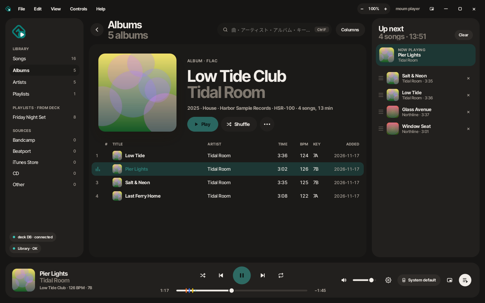
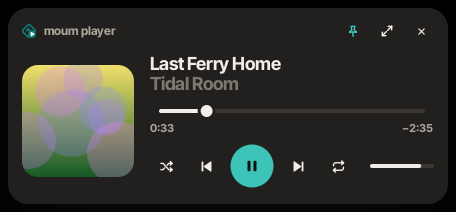
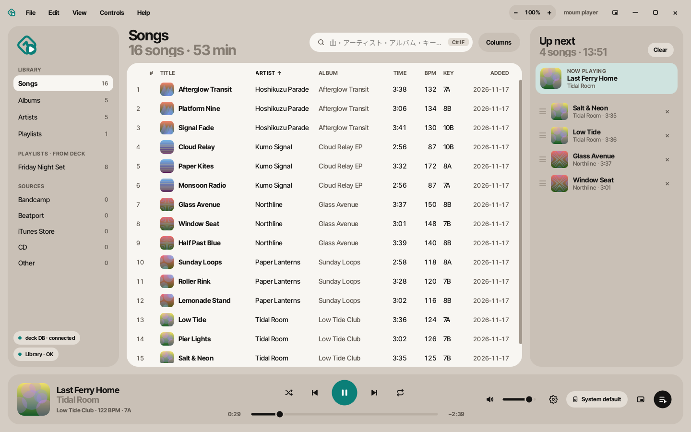

# moum player — 基本の使い方

[🏠 ホーム](../README.md) ｜ **▶️ 基本の使い方** ｜ [🎵 曲の管理](library.md) ｜ [💾 書き出しと設定](export-settings.md) ｜ [❓ 困ったとき](faq.md)

---

## 1. 概要と主な機能

- **ライブラリ表示**：Songs / Albums / Artists / Playlists の 4 つのビュー。検索と並べ替えができます。
- **再生**：ギャップレス再生、再生キュー（Up next）、シャッフル、リピート、出力デバイスの選択、ミニプレイヤー。
  moum deck で付けたキューポイントとループを、シークバーに表示できます。
- **取り込み**：フォルダー、ファイル、iTunes / Music の `Library.xml`。ドラッグ＆ドロップでも取り込めます。
- **曲情報の編集**：タイトル・アーティスト・アルバムなどに加えて、購入日・価格・レーベル・カタログ番号・購入元（Source）を記録できます。
  変更は、音楽ファイルのタグにも書き込めます（初期設定でオン。§6）。
- **整理ツール**：重複の検索、見つからないファイルの再リンク、アーティスト名の統一、ファイルの整理、文字化けしたタグの修復。
- **オンライン検索**：カバー画像と欠けているタグを探します（ボタンを押したときだけ通信します）。
- **健康診断**：ライブラリの問題を定期的に調べて知らせます（何も変更しません）。
- **書き出し**：moum deck 用の USB、この PC の moum deck、rekordbox XML、Traktor NML。
- **表示**：ライト / ダーク、English / 日本語、画面の拡大縮小。

対応する音声形式は、FLAC / MP3 / WAV / AIFF です。M4A（AAC / ALAC）は ffmpeg が必要です（§3-3）。
OGG はまだ再生できません。

### moum deck との関係

moum player は、moum deck のライブラリを**読むだけ**で使います。moum deck のデータは、基本的に書き換えません。
書き込むのは、次の限られた場面だけです。

| 場面 | 何を書くか | いつ |
|---|---|---|
| 取り込んだ曲のフォルダーを登録 | 取り込み先のフォルダーを、moum deck の「ライブラリの取り込み元」に追加します | 取り込みのとき（Settings › moum deck › Add imported folders to moum deck がオンの間。初期設定でオン） |
| タグの再読み込みの依頼 | 「このファイルのタグを読み直して」という依頼を残します | タグをファイルに書き込んだあと。moum deck が起動中でも行います |
| Export › moum deck on this PC | moum player で編集した内容を、moum deck のライブラリに反映します | あなたが実行したとき。**moum deck を閉じている間だけ**。先にバックアップを取ります（§10-2） |

BPM・キー・キューポイント・ビートグリッド・プレイリストは、moum player からは変更しません。それらの編集は moum deck で行います。

---

## 2. インストールと動作環境

- Windows のパソコン。
- このリポジトリの **Releases** から、最新のインストーラーをダウンロードして実行します。
- moum deck は**なくても**使えます。入れておくと、BPM・キー・キューポイント・プレイリストが見られます。
- M4A を再生・取り込みする場合だけ、ffmpeg が必要です（§3-3）。
- 新しいバージョンの自動確認は、今のバージョンにはありません（Settings › Online の「Check for updates」は、まだ使えません）。
  新しい版は、Releases のページから入れてください。設定とライブラリは、入れ直しても消えません（§12）。

---

## 3. はじめかた

### 3-1. 初めての起動とスプラッシュ

起動すると、スプラッシュ画面が出ます。次の順に進み、「Ready」でメイン画面に切り替わります。

1. ライブラリ（設定と moum player のデータ）を開く
2. moum deck のデータベースを読む
3. 曲の確認（編集内容を反映してライブラリを組み立てる）
4. カバー画像を読み込む（最初の画面の分だけ）

スプラッシュの下に、moum deck のデータベースの状態が出ます。

| 表示 | 意味 |
|---|---|
| MOUM DECK DB · CONNECTED | 読めています |
| MOUM DECK DB · NOT FOUND | 見つかりません（moum deck を使っていない場合は、そのままで問題ありません） |
| MOUM DECK DB · LOCKED | 一時的に読めません。しばらくすると自動で読み直します |

スプラッシュは **Settings › General › Show splash screen** でオフにできます。

### 3-2. 曲を入れる

- moum deck を使っている人：moum deck のライブラリが、自動で一覧に出ます。
- moum player で曲を入れる人：**File › Add folder…**（Ctrl O）、**File › Add files…**、**File › Import iTunes library…** を使います（§5）。
  フォルダーやファイルを、ウィンドウにドラッグ＆ドロップしても入れられます。

moum deck のデータベースが別の場所にあるときは、**Settings › moum deck › Locate deck DB** で選びます。

### 3-3. M4A（AAC / ALAC）には ffmpeg が必要

M4A の曲は、ffmpeg がないと再生できません（「再生できません」と表示されます）。

- 再生できない曲があると、お知らせに **Install ffmpeg** が出ます。**Settings › Library › ffmpeg › Install…** からも入れられます（Windows）。
- ボタンを押したときだけ、公開されているビルドをダウンロードし、チェックサムを確認して、`ffmpeg.exe` だけを moum player 専用の場所に置きます。
  ffmpeg は moum player に同梱していません。
- 自分で入れた ffmpeg を使うときは **Locate…** で選びます。
- moum deck が入れた ffmpeg が見つかれば、それも読むだけで使います。

---

## 4. 画面と操作

メニューバーは File / Edit / View / Controls / Help の 5 つです（Alt + 頭文字、または F10 で開けます）。

| メニュー | 項目 |
|---|---|
| File | Add folder… / Add files… / Import iTunes library… / Export library… / Show in folder / Settings… / Exit |
| Edit | Edit properties… / Find / Select all / Copy / Remove from library / Merge artist names… / Organise files… / Write tags to files… / Undo tag writes… / Find duplicates… / Find missing files… / Find missing covers… / Complete missing tags… |
| View | Songs / Albums / Artists / Playlists / Show queue / Dark mode / Zoom in / Zoom out / Actual size / Mini player |
| Controls | Play（再生中は Pause）/ Next / Previous / Shuffle / Repeat off・all・one / Volume up / Volume down |
| Help | Keyboard shortcuts / Third-party notices / Copy last startup timings / Open startup log folder / About moum player |

メニューやボタンの名前は、日本語表示にしても英語のままです（§4-7）。

### 4-1. ライブラリの 4 つのビュー

| Artists | アルバムの詳細 |
|---|---|
|  |  |

- **Songs**：曲の一覧。列は TITLE / ARTIST / ALBUM / TIME / BPM / KEY / SOURCE / ADDED / LABEL / CAT# / PURCHASED / PRICE。
  表示する列は、列の選択（Columns）で変えられます。
- **Albums**：アルバムの一覧（グリッド表示とリスト表示）。開くと、アルバムの中の曲が出ます。
- **Artists**：アーティストの一覧。開くと、そのアーティストの曲が出ます。
- **Playlists**：moum deck のプレイリストが、読み取り専用で出ます。**Settings › moum deck › Show deck playlists** で表示をオフにできます。

切り替えは、左のサイドバーか、**View** メニュー（Ctrl 1〜4）です。サイドバーでは、購入元（Source）ごとに絞り込めます。

### 4-2. 検索と並べ替え

- **検索**：Ctrl F で検索欄に移動します。タイトル・アーティスト・アルバム・キー・レーベル・カタログ番号が対象です。
- **曲の並べ替え**：列の見出し（TITLE / ARTIST / ALBUM / TIME / BPM / KEY / SOURCE / ADDED など）をクリックすると、昇順・降順が切り替わります。
  並べ方は、次の起動でも保たれます。
- **アルバムの並べ替え**：Albums ビューの並べ替えボタンから、**Newest first**（新しい順）/ **Oldest first**（古い順）/ **Name (A–Z)** を選びます。
  新しい・古いは、アルバムの曲の追加日で決まります。

### 4-3. アルバムのアーティスト表示

アルバムに表示するアーティスト名は、表示のためだけに、次の順で決めます（ファイルや moum deck には書きません）。

1. 曲に「アルバムアーティスト」があれば、それ。
2. なければ、過半数の曲が同じ名前のとき、その名前。
3. それもなければ、「feat. …」や「&」「,」などの手前の、主なアーティスト名が過半数のとき、その名前。
4. それでも決まらないときは **Various Artists**。

### 4-4. 再生

- **再生・一時停止**：Space。**前後の曲**：Ctrl → / Ctrl ←。**シーク**：← / →（5 秒ずつ）。**音量**：Ctrl ↑ / Ctrl ↓。
- **ギャップレス**：同じアルバムの曲が続くとき、曲の間に無音を入れません（次の曲を先に読み込みます）。
  **Settings › Playback › Gapless playback** でオフにできます。
- **再生キュー**：曲を右クリックして **Play next**（次に再生）/ **Add to queue**（キューの最後に追加）。
  **Show queue**（Ctrl Q）で、Up next を表示します。ウィンドウが狭いと、キューは自動で隠れます。
- **シャッフル / リピート**：Controls メニューか、プレーヤーのボタン。リピートは Off / All / One。
- **出力デバイス**：プレーヤーの出力ボタン、または **Settings › Playback › Output device** で選びます（System default もあります）。
  出力デバイスのサンプルレートに合わせて、自動で変換して再生します。
- **ミニプレイヤー**：**View › Mini player**（Ctrl M）。小さなウィンドウで、再生・前後・シャッフル・リピート・音量を操作できます。
  ピンで最前面に固定できます。フルウィンドウに戻すボタンもあります。
- **前回の続きから**：次に起動したとき、同じ曲・位置・キューで再開します（**Settings › Playback › Resume where I left off**。初期設定でオン）。
- **キューポイントとループ**：moum deck で付けたホットキューとループが、シークバーに表示されます（**Settings › moum deck › Show cue points**）。
  表示だけで、moum player では編集できません。
- **BPM とキー**：moum deck の解析結果を表示します（**Show BPM and key**）。
  moum deck の解析がない曲は、**Estimate missing BPM** がオンなら、仮の BPM をバックグラウンドで推定して、薄い色で表示します。moum deck の解析は上書きしません。

### 4-5. 曲の右クリックメニュー

- 曲：Play / Play next / Add to queue / Go to album / Go to artist / Edit properties… / Fix garbled tags… / Complete missing tags… / Show in folder
- アルバム：Play / Play next / Add to queue / Edit album info… / Change artwork… / Find cover online… / Show in folder
- アーティスト：Play / Play next / Add to queue / Go to artist

その場で使えない項目は、メニューに出ません。

### 4-6. ライブラリから外す

曲を選んで **Edit › Remove from library**（Del）を押すと、その曲が moum player の一覧から隠れます。
**ファイルも moum deck のデータも、そのままです。** 画面下の「Undo」で戻せます。

### 4-7. 表示の設定

- **Dark mode**：Ctrl D。
- **表示サイズ**：Ctrl + / Ctrl − / Ctrl 0（Settings › General › Display size）。画面に収まらないときは小さくします。
- **Language**：English / 日本語。日本語にするのは説明文とメッセージだけで、メニュー・ボタン・見出しなどの短い名前は英語のままです。
