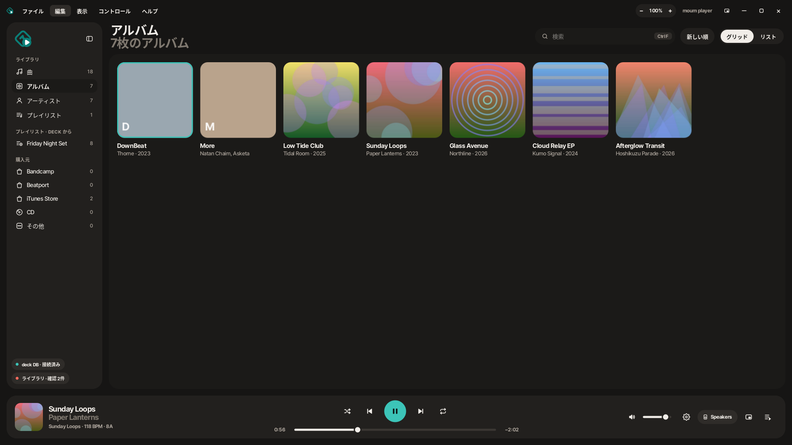
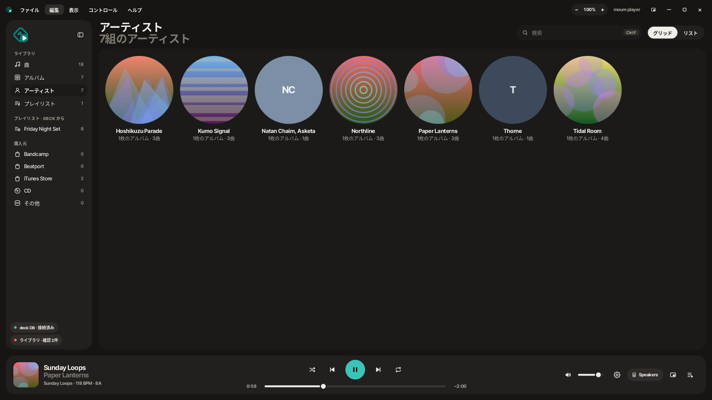
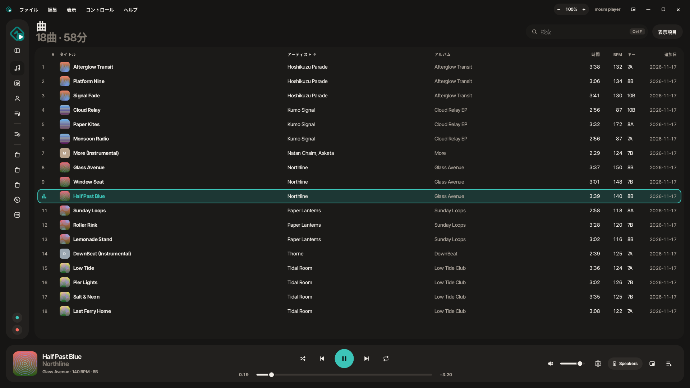
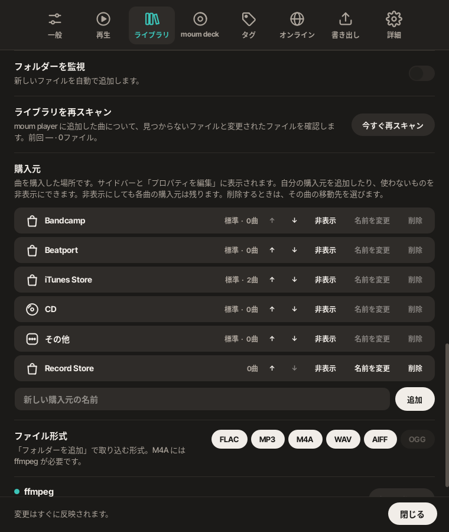

# moum player — 基本の使い方

[🏠 ホーム](../README.md) ｜ **▶️ 基本の使い方** ｜ [🎵 曲の管理](library.md) ｜ [💿 CD・変換・オンライン](cd-convert-online.md) ｜ [💾 書き出しと設定](export-settings.md) ｜ [❓ 困ったとき](faq.md)

---

## 1. 概要と主な機能

- **ライブラリ表示**：「曲」「アルバム」「アーティスト」「プレイリスト」の 4つのビュー。検索と並べ替えができます。
  2枚組などのアルバムは、ディスクごとに見出しが付いて並びます（§4-11）。
- **再生**：ギャップレス再生、再生キュー（「次はこちら」）、シャッフル、リピート、出力デバイスの選択、ミニプレーヤー。
  moum deck で付けたキューポイントとループを、シークバーに表示できます。
- **取り込み**：フォルダー、ファイル、iTunes / Music の `Library.xml`。ドラッグ＆ドロップでも取り込めます。
- **CD の取り込み**：音楽 CD を、AIFF（初期設定）などのファイルにして取り込みます。
  MusicBrainz で CD を特定して、タグとジャケットを自動で入れます。AccurateRip で、正確に取り込めたかも確かめられます（§6）。
- **ファイルの変換**：曲のファイルを、AIFF・WAV・FLAC・ALAC・MP3・AAC に変換します。元のファイルはバックアップできます（§7）。
- **曲情報の編集**：タイトル・アーティスト・アルバム・ディスク番号などに加えて、購入日・価格・レーベル・カタログ番号・購入元を記録できます。
  変更は、音楽ファイルのタグにも書き込めます（初期設定でオン。§8）。
- **整理ツール**：重複の検索、見つからないファイルの再リンク、アーティスト名の統一、ファイルの整理、文字化けしたタグの修復（§9）。
- **オンライン検索**：ジャケットと欠けているタグを探します。持っているアルバムの情報を、MusicBrainz で調べ直すこともできます（§10）。
  ボタンを押したときだけ通信します。
- **健康診断**：ライブラリの問題を定期的に調べて知らせます（何も変更しません）。
- **書き出し**：moum deck 用の USB、この PC の moum deck、rekordbox XML、Traktor NML。
- **表示**：ライト / ダーク、English / 日本語、画面の拡大縮小、サイドバーのたたみ込み、パネルの幅の変更。
  日本語にすると、メニュー・ボタン・見出し・メッセージのすべてが日本語になります。

対応する音声形式は、FLAC / MP3 / WAV / AIFF です。M4A（AAC / ALAC）は ffmpeg が必要です（§3-3）。
OGG はまだ再生できません。

### moum deck との関係

moum player は、moum deck のライブラリを**読むだけ**で使います。moum deck のデータは、基本的に書き換えません。
書き込むのは、次の限られた場面だけです。

| 場面 | 何を書くか | いつ |
|---|---|---|
| 取り込んだ曲のフォルダーを登録 | 取り込み先のフォルダーを、moum deck の「ライブラリの取り込み元」に追加します | 取り込みのとき（設定 › moum deck › 取り込んだフォルダーを moum deck に追加 がオンの間。初期設定でオン）。CD の取り込みでも同じです |
| タグの再読み込みの依頼 | 「このファイルのタグを読み直して」という依頼を残します | タグをファイルに書き込んだあと。moum deck が起動中でも行います |
| 書き出し › この PC の moum deck | moum player で編集した内容を、moum deck のライブラリに反映します | あなたが実行したとき。**moum deck を閉じている間だけ**。先にバックアップを取ります（§12-2） |

BPM・キー・キューポイント・ビートグリッド・プレイリストは、moum player からは変更しません。それらの編集は moum deck で行います。
ファイルの変換（§7）で変わった曲のパスは、「この PC の moum deck」への書き出しで、moum deck にも反映できます。

---

## 2. インストールと動作環境

- Windows のパソコン。
- このリポジトリの **Releases** から、最新のインストーラーをダウンロードして実行します。
- moum deck は**なくても**使えます。入れておくと、BPM・キー・キューポイント・プレイリストが見られます。
- M4A を再生・取り込みする場合と、CD を ALAC / AAC で取り込む場合、曲を ALAC / AAC に変換する場合は、ffmpeg が必要です（§3-3）。
- CD の取り込みは、Windows でだけ使えます。CD ドライブが必要です。
- 新しいバージョンの自動確認は、今のバージョンにはありません（設定 › オンライン の「アップデートを確認」は、まだ使えません）。
  新しい版は、Releases のページから入れてください。設定とライブラリは、入れ直しても消えません（§14）。
  **更新の前に、データフォルダーのバックアップを取ってください**（§14）。

---

## 3. はじめかた

### 3-1. 初めての起動とスプラッシュ

起動すると、スプラッシュ画面が出ます。次の順に進み、「準備完了」でメイン画面に切り替わります。

1. ライブラリ（設定と moum player のデータ）を開く
2. moum deck のデータベースを読む
3. 曲の確認（編集内容を反映してライブラリを組み立てる）
4. ジャケットを読み込む（最初の画面の分だけ）

スプラッシュの下に、moum deck のデータベースの状態が出ます。

| 表示 | 意味 |
|---|---|
| MOUM DECK DB · 接続済み | 読めています |
| MOUM DECK DB · 見つかりません | 見つかりません（moum deck を使っていない場合は、そのままで問題ありません） |
| MOUM DECK DB · 使用中 | 一時的に読めません。しばらくすると自動で読み直します |

スプラッシュは **設定 › 一般 › 起動画面を表示** でオフにできます。

### 3-2. 曲を入れる

- moum deck を使っている人：moum deck のライブラリが、自動で一覧に出ます。
- moum player で曲を入れる人：**ファイル › フォルダーを追加…**（Ctrl O）、**ファイル › ファイルを追加…**、**ファイル › iTunes ライブラリを取り込む…** を使います（§5）。
  フォルダーやファイルを、ウィンドウにドラッグ＆ドロップしても入れられます。
- CD から入れる人：**ファイル › CD を取り込む…**（Ctrl Shift I）を使います（§6）。

moum deck のデータベースが別の場所にあるときは、**設定 › moum deck** の **場所を指定…** で選びます。

### 3-3. M4A（AAC / ALAC）には ffmpeg が必要

M4A の曲は、ffmpeg がないと再生できません（「この形式の再生には ffmpeg が必要ですが、見つからないため再生できません。」と表示されます）。
CD の取り込みと曲の変換でも、ALAC（Apple Lossless）と AAC は ffmpeg がないと選べません。

- 再生できない曲があると、お知らせに **ffmpeg をインストール** が出ます。**設定 › ライブラリ › ffmpeg › インストール…** からも入れられます（Windows）。
- ボタンを押したときだけ、公開されているビルドをダウンロードし、チェックサムを確認して、`ffmpeg.exe` だけを moum player 専用の場所に置きます。
  ffmpeg は moum player に同梱していません。
- 自分で入れた ffmpeg を使うときは **場所を指定…** で選びます。
- moum deck が入れた ffmpeg が見つかれば、それも読むだけで使います。

---

## 4. 画面と操作

メニューバーは「ファイル」「編集」「表示」「コントロール」「ヘルプ」の 5つです（Alt + F / E / V / C / H、または F10 で開けます）。

| メニュー | 項目 |
|---|---|
| ファイル | フォルダーを追加… / ファイルを追加… / iTunes ライブラリを取り込む… / CD を取り込む… / moum deck から取り込む…（今は選べません）/ ライブラリを書き出す… / MOUM_USB へもう一度書き出す（今は選べません）/ フォルダーで表示 / 設定… / 終了 |
| 編集 | プロパティを編集… / 検索 / すべて選択 / コピー / ライブラリから削除 / アーティスト名を統一… / ファイルを整理… / 変換… / タグをファイルに書き込む… / タグの書き込みを元に戻す… / 重複を探す… / 見つからないファイルを探す… / ジャケットのないアルバムを探す… / 足りないタグを補う… / 選択したアルバムの情報をオンラインで調べる… / すべてのアルバムの情報をオンラインで調べる… |
| 表示 | 曲 / アルバム / アーティスト / プレイリスト / キューを表示 / サイドバーをたたむ（たたんでいるときは「サイドバーを広げる」）/ ダークモード / 拡大 / 縮小 / 実際のサイズ / ミニプレーヤー |
| コントロール | 再生（再生中は「一時停止」）/ 次へ / 前へ / シャッフル / リピートしない・全曲をリピート・1曲をリピート / 音量を上げる / 音量を下げる |
| ヘルプ | キーボードショートカット / サードパーティのライセンス表記 / 直近の起動タイミングをコピー / 起動ログのフォルダーを開く / moum player について |

その場で使えない項目は、グレーになります。

### 4-1. ライブラリの 4つのビュー

| アルバム | アーティスト |
|---|---|
|  |  |

- **曲**：曲の一覧。列は タイトル / アーティスト / アルバム / 時間 / BPM / キー / 購入元 / 追加日 / レーベル / カタログ番号 / 購入日 / 価格。
  初めは、アルバム・BPM・キー・追加日の列が出ています。ほかの列は、「表示項目」のボタンで出せます。
- **アルバム**：アルバムの一覧（「グリッド」表示と「リスト」表示）。開くと、アルバムの中の曲が出ます。
- **アーティスト**：アーティストの一覧。開くと、そのアーティストの曲が出ます。
- **プレイリスト**：moum deck のプレイリストが、読み取り専用で出ます。**設定 › moum deck › deck のプレイリストを表示** で表示をオフにできます。

切り替えは、左のサイドバーか、**表示** メニュー（Ctrl 1〜4）です。サイドバーでは、購入元ごとに絞り込めます。

### 4-2. 検索と並べ替え

- **検索**：Ctrl F で検索欄に移動します。タイトル・アーティスト・アルバム・キー・レーベル・カタログ番号が対象です。
- **曲の並べ替え**：列の見出し（タイトル / アーティスト / アルバム / 時間 / BPM / キー / 購入元 / 追加日 など）をクリックすると、昇順・降順が切り替わります。
  並べ方は、次の起動でも保たれます。
- **アルバムの並べ替え**：「アルバム」ビューの並べ替えボタンから、**新しい順** / **古い順** / **名前順** を選びます。
  新しい・古いは、アルバムの曲の追加日で決まります。

### 4-3. アルバムのアーティスト表示

アルバムに表示するアーティスト名は、表示のためだけに、次の順で決めます（ファイルや moum deck には書きません）。

1. 曲に「アルバムアーティスト」があれば、それ。
2. なければ、過半数の曲が同じ名前のとき、その名前。
3. それもなければ、「feat. …」や「&」「,」などの手前の、主なアーティスト名が過半数のとき、その名前。
4. それでも決まらないときは **Various Artists**。

### 4-4. 再生

- **再生・一時停止**：Space。**前後の曲**：Ctrl → / Ctrl ←。**シーク**：← / →（5秒ずつ）。**音量**：Ctrl ↑ / Ctrl ↓。
- **ギャップレス**：同じアルバムの曲が続くとき、曲の間に無音を入れません（次の曲を先に読み込みます）。
  **設定 › 再生 › ギャップレス再生** でオフにできます。
- **再生キュー**：曲を右クリックして **次に再生** / **キューに追加**（キューの最後に追加）。
  **キューを表示**（Ctrl Q）で、「次はこちら」を表示します。ウィンドウが狭いと、キューは自動で隠れます。
  「次はこちら」は、最初は閉じています。プレーヤーバーの **キュー** ボタンか、Ctrl Q で開けます。
- **シャッフル / リピート**：コントロールメニューか、プレーヤーのボタン。リピートは「リピートしない」「全曲をリピート」「1曲をリピート」。
- **出力デバイス**：プレーヤーの出力ボタン、または **設定 › 再生 › 出力デバイス** で選びます（「システムの既定」もあります）。
  出力デバイスのサンプルレートに合わせて、自動で変換して再生します。
- **ミニプレーヤー**：**表示 › ミニプレーヤー**（Ctrl M）。小さなウィンドウで、再生・前後・シャッフル・リピート・音量を操作できます。
  ピンで最前面に固定できます。フルウィンドウに戻すボタンもあります。
- **前回の続きから**：次に起動したとき、同じ曲・位置・キューで再開します（**設定 › 再生 › 前回の続きから再生**。初期設定でオン）。
- **キューポイントとループ**：moum deck で付けたホットキューとループが、シークバーに表示されます（**設定 › moum deck › キューポイントを表示**）。
  表示だけで、moum player では編集できません。
- **BPM とキー**：moum deck の解析結果を表示します（**BPM とキーを表示**）。
  moum deck の解析がない曲は、**足りない BPM を推定** がオンなら、仮の BPM をバックグラウンドで推定して、薄い色で表示します。moum deck の解析は上書きしません。

### 4-5. 曲の右クリックメニュー

- 曲：再生 / 次に再生 / キューに追加 / アルバムへ移動 / アーティストへ移動 / プロパティを編集… / 文字化けを直す… / 足りないタグを補う… / アルバム情報をオンラインで調べる… / 変換… / フォルダーで表示
- アルバム（カードを右クリック、またはアルバムのページの「…」ボタン）：再生 / 次に再生 / キューに追加 / アルバム情報を編集… / ジャケットを変更… / ジャケットをオンラインで探す… / アルバム情報をオンラインで調べる… / フォルダーで表示
- アーティスト：再生 / 次に再生 / キューに追加 / アーティストへ移動

その場で使えない項目は、メニューに出ません。

### 4-6. ライブラリから外す

曲を選んで **編集 › ライブラリから削除**（Del）を押すと、その曲が moum player の一覧から隠れます。
**ファイルも moum deck のデータも、そのままです。** 画面下の「元に戻す」で戻せます。

### 4-7. 表示の設定

- **ダークモード**：Ctrl D。
- **表示サイズ**：Ctrl + / Ctrl − / Ctrl 0（設定 › 一般 › 表示サイズ）。画面に収まらないときは小さくします。
- **言語**：English / 日本語（設定 › 一般 › 言語）。日本語にすると、メニュー・ボタン・見出し・列の名前・メッセージが、すべて日本語になります。
  moum player・moum deck・rekordbox・Traktor・iTunes・MusicBrainz などの名前と、AIFF・FLAC などの形式名は、そのままです。

### 4-8. サイドバーとアイコン

左のサイドバーには、「ライブラリ」（曲・アルバム・アーティスト・プレイリスト）、「プレイリスト · DECK から」、「購入元」が並びます。
どの項目にも、アイコンが付いています。

サイドバーは、アイコンだけの細い表示（レール）にたためます。次のどれでも、たたんだり広げたりできます。

- ロゴの横のボタン（たたむときは「サイドバーをたたむ」、広げるときは「サイドバーを広げる」）
- **表示 › サイドバーをたたむ**（たたんでいるときは「サイドバーを広げる」）
- **Ctrl B**
- サイドバーとその右の一覧の境界線を、左へ細くドラッグ（細くしすぎるとレールになります）。レールの境界線を右へドラッグすると、元の幅に広がります。

たたんだあと広げると、たたむ前の幅に戻ります。この状態は、次の起動でも保たれます。

### 4-9. 購入元の管理と購入元のアイコン

購入元（Source）は、曲をどこで買ったかの記録です。初めから「Bandcamp」「Beatport」「iTunes Store」「CD」「その他」があります。
自分の購入元も作れます。

- 開き方：**設定 › ライブラリ › 購入元**。または、サイドバーの「購入元」の見出しや購入元を右クリックして **購入元を管理…**。
- **追加**：「新しい購入元の名前」に名前を入れて **追加**（40文字まで）。
- **名前を変更 / 削除**：自分で作った購入元だけです。初めからある購入元は、名前を変えたり削除したりできません（**非表示** にはできます）。
  削除するときは、その購入元の曲の移動先を選びます。
- **上へ / 下へ**：並び順を変えます。
- **非表示 / 表示**：サイドバーと「プロパティを編集」から隠します。隠しても、各曲の購入元は残ります。
- 曲への設定は、「プロパティを編集」の「購入元」で行います（§8-1）。そこにある「+ 追加…」からも、購入元を足せます。

**購入元のアイコン**：購入元の左のアイコンを押すと、アイコンを選べます。

- 標準のアイコンから選ぶ：ストア / ダウンロード / ディスク / レコード / カセット / ギフト / クラウド / その他。
- 自分の画像を使う：**画像を選択…** で、PNG・JPEG・SVG・ICO の画像を選びます（2MB まで）。
  画像のコピーが、moum player 専用のフォルダー（`source_icons`。§14）に保存されます。元の画像は、消しても動きます。
- **アイコンを外す**：その購入元の標準のアイコンに戻します。

初めに付いているアイコンは、汎用の絵です。ストアのロゴ（Bandcamp など）は、moum player に入っていません。
ロゴを使いたいときは、ご自分でロゴの画像を用意して **画像を選択…** で設定してください。ロゴの利用条件は、各社の規約に従ってください。

### 4-10. パネルの幅とウィンドウ

- **パネルの幅**：サイドバーと曲の一覧の境界線、曲の一覧と「次はこちら」の境界線をドラッグすると、幅を変えられます。
  境界線をダブルクリックすると、初めの幅に戻ります。幅は、次の起動でも保たれます。
- **起動時のウィンドウ**：画面いっぱいに開きます。最大化を解除してから閉じたときは、次の起動で最大化せずに開きます。
  また最大化して閉じると、また画面いっぱいに開きます。

### 4-11. 複数ディスクのアルバム

2枚以上のディスクの曲があるアルバム（「ディスク 1」「ディスク 2」など）は、次のように表示されます。

- アルバムのページで、曲が「ディスク1」「ディスク2」の見出しごとに並びます。
- アルバムの見出しの情報に「2枚組」と出ます。
- ディスク番号がない曲は、ディスク1として扱います。

ディスク番号と枚数は、曲を選んで **編集 › プロパティを編集…** で変えられます。「ディスク」の欄に、番号と総数を「1 / 2」の形で入れます（99まで）。
複数の曲をまとめて選んだときも同じです。変えた内容は、ファイルのタグにも書き込めます（§8-2）。

CD を取り込むときは、ディスク番号と枚数を取り込み画面で入れます（§6-9）。
MusicBrainz でアルバム情報を調べると、ディスク番号と枚数も正しく入ります（§10-2）。

---

moum player v1.1.0 の説明です。スクリーンショットに写っている曲は撮影用のサンプルです。
