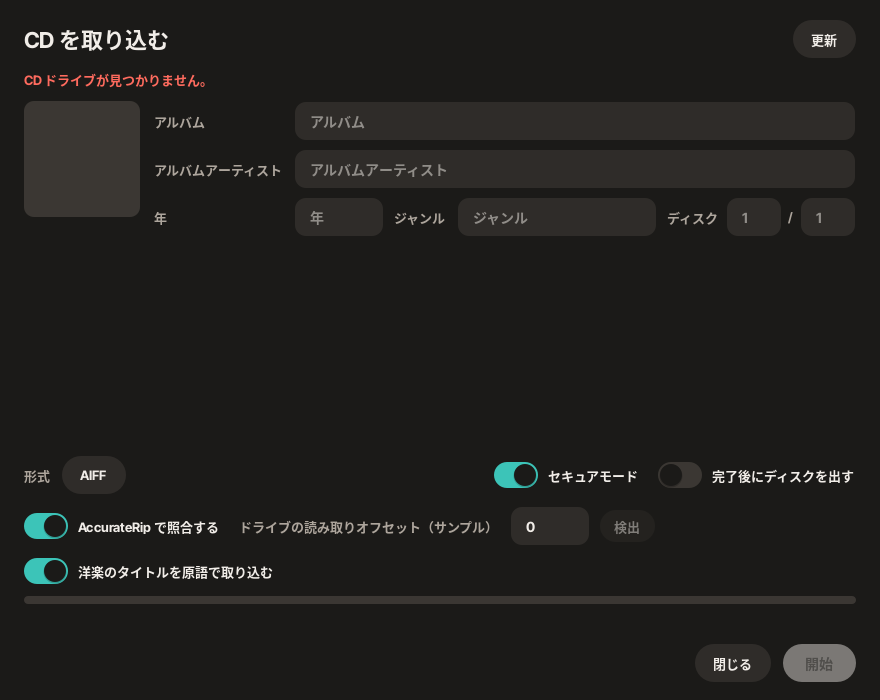
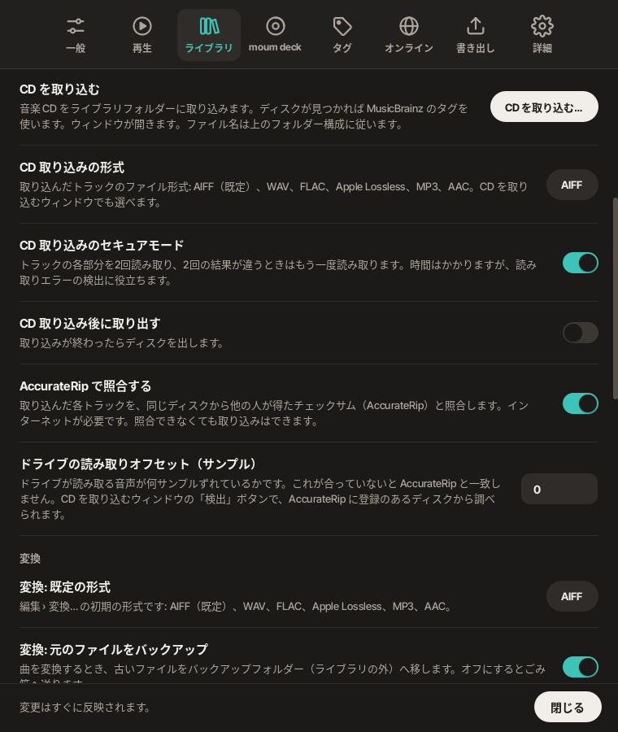
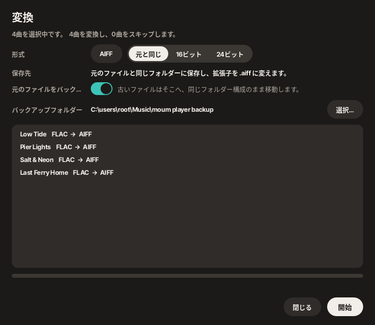
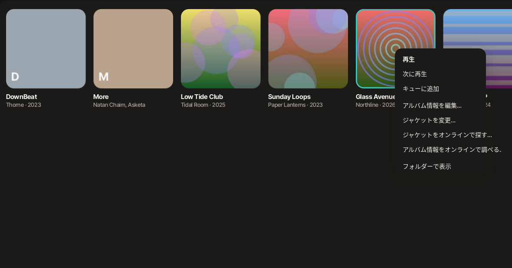

# moum player — CD・変換・オンライン

[🏠 ホーム](../README.md) ｜ [▶️ 基本の使い方](basics.md) ｜ [🎵 曲の管理](library.md) ｜ **💿 CD・変換・オンライン** ｜ [💾 書き出しと設定](export-settings.md) ｜ [❓ 困ったとき](faq.md)

---

## 6. CD を取り込む

手持ちの音楽 CD を、ライブラリフォルダーのファイルにして取り込みます。**Windows でだけ使えます。** CD ドライブが必要です。

### 6-1. 取り込みを始める

1. CD ドライブに、音楽 CD を入れます。
2. **ファイル › CD を取り込む…**（Ctrl Shift I）を開きます。「CD を取り込む」のウィンドウが開きます。
   moum player のライブラリを保存できない状態のときは、選べません。
3. ディスクを読み取って、MusicBrainz で CD を探します。
4. アルバム名・曲名などを確かめて、**開始** を押します。

ドライブが複数あるときは、右上のボタンでドライブを選びます。ディスクを入れ替えたときは **更新** を押します。
ドライブが見つからないときは「CD ドライブが見つかりません。」と出ます。
ウィンドウの上には、「オーディオ 12トラック、56分」のような、ディスクの情報が出ます。データトラックは取り込みません。

設定の **設定 › ライブラリ › CD 取り込み** にも、同じ項目があります（CD を取り込むウィンドウでも変えられます）。

### 6-2. CD の特定：MusicBrainz と CD-Text

- ディスクの目次から、MusicBrainz でその CD を探します。見つかると、アルバム名・アルバムアーティスト・年・ジャンル・レーベル・カタログ番号・曲名・アーティストが自動で入ります。
  「MusicBrainz で見つかりました。開始する前に内容を確認してください。」と出ます。
- 同じディスクが複数のリリース（国や版の違い）で登録されているときは、「リリース」の欄で選べます。
- MusicBrainz に登録がない CD、つながらないとき、設定でオンライン検索をオフにしているときは、**ディスクに入っている CD-Text** を使います。
  アルバム名・アルバムアーティスト・曲名・アーティストが入ります。内容は確認してください。
  CD-Text もないときは、空の欄に自分で入力します。
- どの欄も、取り込む前に自由に直せます。取り込まないトラックは、チェックを外します。
- **ジャンル**：MusicBrainz で一番多く付けられているジャンルが入ります（なければ、一番多いタグ）。「ジャンル」の欄で直せます。

オンライン検索のオン・オフは、**設定 › オンライン › ジャケットとタグをオンラインで検索** です（§10-4）。

### 6-3. 曲名：原語の曲名と、ストアの曲名

- **洋楽のタイトルを原語で取り込む**（初期設定でオン）：洋楽の日本盤は、曲名・アルバム名・アーティスト名がカタカナのことがあります。
  オンにすると、MusicBrainz にある原語の名前（レコーディング・リリースグループ・アーティストの正式名）を使います。
  日本のアーティストの作品や、原語の名前がない曲は変わりません。
  ウィンドウの中のスイッチと、**設定 › オンライン** の同じ名前の設定は、同じものです。
- **ストアの曲名**：CD にバーコードがあり、iTunes や Deezer でそのアルバムが見つかったときは、曲名にストアの表記を使います。
  MusicBrainz では「featuring …」がアーティスト名のほうに移っていることがあります。ストアの曲名は、発売されたままの表記です。
  「曲名は iTunes の表記です。」のように、どこの表記かが一覧の下に出ます。
  曲の長さと番号が合う曲だけ、ストアの曲名になります。合わない曲は MusicBrainz の曲名のままです。アーティスト名は、ストアのものを使いません。

### 6-4. ジャケット

- ジャケットの候補を、iTunes・Deezer・MusicBrainz（Cover Art Archive）から集めて、小さな画像で並べます。画像の下に、大きさ（ピクセル）が出ます。
  画像にカーソルを合わせると、取得元が出ます。
- 並び順：バーコードが一致したもの、アルバム名で見つけたもの、同じアルバムの**別の版**（配信版など）で見つけたもの、MusicBrainz のジャケット、の順です。
  一番前の候補が、初めから選ばれています。MusicBrainz のジャケットは、スキャンや写真のことがあるので、あとに回します。
- 候補のクリックで、使うジャケットを選び直せます。選んだものが、取り込む曲に埋め込まれます。
- **画像を選択…**：手持ちの JPEG か PNG の画像を、ジャケットにできます（30MB まで）。
- 取得できないときは「ジャケット画像を取得できませんでした。」と出て、**再試行** が使えます（§16）。
  見つからないときは「ジャケット画像が見つかりません。」と出ます。
- ジャケットの候補を集めている間、**開始** は待ちます。
- CD-Text だけで MusicBrainz にない CD は、CD-Text のアーティスト名とアルバム名で、ストアを探します。

### 6-5. 形式・セキュアモード・ディスクを出す

| 項目 | 内容 |
|---|---|
| 形式 | **AIFF**（初期設定）/ WAV / FLAC / ALAC (Apple Lossless) / MP3 / AAC。ALAC と AAC は ffmpeg が必要で、ffmpeg がないと選べません（§3-3） |
| ビットレート | MP3 と AAC のときだけ。128 / 192 / 256 / 320 kbps（初期値 256） |
| セキュアモード | 初期設定でオン。トラックの各部分を 2回読み取り、2回の結果が違うときはもう一度読み取ります。時間はかかりますが、読み取りエラーに強くなります |
| 完了後にディスクを出す | 初期設定でオフ。オンにすると、取り込みが終わったらディスクを出します |

形式は、設定 › ライブラリ › 「CD 取り込みの形式」でも選べます。取り込まれるファイルには、タグ（アルバム・アーティスト・曲名・年・ジャンル・レーベル・カタログ番号など）とジャケットが入ります。
MusicBrainz で見つけた CD は、そのリリースの ID もファイルに入ります。あとで「アルバム情報をオンラインで調べる」（§10-2）を使うとき、正確に探せます。

### 6-6. AccurateRip で照合する

取り込んだ音が正確かを、同じディスクから世界中の人が取り込んだ結果（AccurateRip）と照らし合わせます。

- **AccurateRip で照合する**（初期設定でオン）：インターネットが必要です。つながらなくても、取り込みはできます。
- 取り込み後、トラックごとに結果が出ます。

| 表示 | 意味 |
|---|---|
| 正確に取り込めました(信頼度N) | 他の人の結果と一致しました。Nは、同じ結果を出した人の数です |
| AccurateRip に登録がありません | このディスクは、AccurateRip にまだありません。取り込みの失敗ではありません |
| 一致しません | 他の人の結果と違います。傷や汚れ、またはドライブのオフセット違いが考えられます |
| オフセット未設定 | ドライブの読み取りオフセットが決まっていないため、一致しないトラックを判定できません |
| 照合できませんでした | 通信できなかったなどの理由で、照合できませんでした |

- 最後に「AccurateRip で正確に取り込めたトラック: 12曲中12曲。」のようなまとめが出ます。

**ドライブの読み取りオフセット（サンプル）**：ドライブが読み取る音が、何サンプルずれているかです。これが合っていないと、AccurateRip と一致しません。
ドライブの型番ごとに、値が保存されます。

- 値がわかるときは、欄に直接入れます（AccurateRip のドライブ一覧に載っています）。
- わからないときは、**検出** を押します。AccurateRip に登録のあるディスクで、ドライブのオフセットを調べます。
  オンライン検索がオンで、ディスクが AccurateRip に登録されている必要があります。よく知られたディスクで試してください。
  結果は「読み取りオフセットを検出しました: 6サンプル（信頼度30）。」のように出ます。
- 検出できなかったときは、理由が出ます（ディスクが登録されていない、AccurateRip につながらない、ディスクが読めない、オフセットが見つからない、など）。

### 6-7. 取り込みを実行する

- **開始** で、チェックを入れたトラックの取り込みが始まります。「トラック 3 / 12」のように進みます。
- ファイルは、ライブラリフォルダーに入ります。ファイル名の付け方は、**設定 › ライブラリ › フォルダー構成** に従います（§5-1 と同じです）。
  同じ名前のファイルがあっても、上書きしません（名前に「 (2)」が付きます）。
- 取り込んだ曲は、そのままライブラリに入ります。**設定 › moum deck › 取り込んだフォルダーを moum deck に追加** がオンなら、フォルダーを moum deck にも登録します（「moum deck に追加しました。」）。
- **キャンセル**：完了したトラックは残ります。書きかけのファイルは残りません。
- 読み取れない部分があったトラックは、無音で埋めて、その数を知らせます。ディスクが途中で読めなくなったときは、そこで止まります。
- 終わると「完了」と出ます。もう一度同じ画面で取り込みたいときは **もう一度取り込む** を使います。

### 6-8. 2枚組などのディスク

- MusicBrainz で見つかった CD は、何枚目か（ディスク番号）と、全部で何枚か（総数）が自動で入ります。
- 自分で入れるときは、「ディスク」の欄に「1」「/」「2」のように入れます。
- 2枚目も、同じアルバム名・アーティスト・ディスク総数で取り込むと、ライブラリで 1つのアルバムにまとまり、「ディスク1」「ディスク2」の見出しで並びます（§4-11）。

---

## 7. ファイルを変換する

曲のファイルを、別の形式に変換します。変換した曲は、元のファイルの代わりにライブラリに入ります。
曲の編集内容・追加日・再生回数・ジャケットは、そのまま残ります。タグとジャケットは、新しいファイルに引き継がれます。

### 7-1. 変換のしかた

1. 変換したい曲を、曲の一覧で選びます（複数でも可）。
2. **編集 › 変換…**、または曲を右クリックして **変換…** を選びます。「変換」のウィンドウが開きます。
3. 設定を決めて、**開始** を押します。

| 項目 | 内容 |
|---|---|
| 形式 | AIFF（初期設定）/ WAV / FLAC / ALAC (Apple Lossless) / MP3 / AAC。ALAC と AAC は ffmpeg が必要です（§3-3） |
| 品質 | AIFF・WAV・FLAC・ALAC は「元と同じ」「16ビット」「24ビット」。MP3 は 128 / 192 / 256 / 320 kbps と V0（可変）。AAC は 128 / 192 / 256 / 320 kbps |
| 保存先 | 元のファイルと同じフォルダーです。拡張子だけが変わります |
| 元のファイルをバックアップ | 初期設定でオン（下記） |
| バックアップフォルダー | バックアップの置き場所。**選択…** で変えられます |

ウィンドウに、変換する曲と、変換しない曲（理由つき）が一覧で出ます。変換しない理由は、たとえば次のとおりです。

- すでにこの形式です
- ファイルが見つかりません
- 読み込みに ffmpeg が必要です
- 新しい名前のファイルがすでにあります
- 再生中
- このPC上のファイルではありません
- 別の曲が同じ新しい名前になります

変換は、1曲ごとに「全部できるか、何もしないか」です。途中で失敗した曲は、元のままです。**キャンセル** で止めたときも、終わった曲は残ります。
終わると、曲ごとの結果が出ます。

### 7-2. 元のファイルのバックアップ

- **元のファイルをバックアップ（オン）**：変換前のファイルを、バックアップフォルダーに移します。ライブラリフォルダーの中と同じフォルダー構成で入ります。
  初期のバックアップフォルダーは、ミュージックフォルダー内の `moum player backup` です。
  **ライブラリフォルダーの外**を選んでください（中は選べません）。
- **オフ**：変換前のファイルは、ごみ箱に送られます。
- 変換後、「バックアップフォルダーを開く」で、置き場所を開けます。

この 2つは、**設定 › ライブラリ › 変換** の「変換: 元のファイルをバックアップ」「バックアップフォルダー」で、先に決めておけます。
同じ場所の「変換: 既定の形式」は、変換ウィンドウを開いたときの形式です。

### 7-3. moum deck の曲を変換したとき

moum deck が知っている曲も変換できます。moum deck のデータベースは、この時点では変わりません。
moum deck でも新しいファイルを使うには、moum deck を閉じて、**ファイル › ライブラリを書き出す…** で「この PC の moum deck」を実行します（§12-2）。
キューポイントなどは、そのまま残ります。ただし、MP3 や AAC などの非可逆形式に変換すると、キューの位置が少しずれることがあります。

---

## 10. ジャケット・アルバム情報のオンライン検索

**ボタンを押したとき（または、メニューから開いたとき）だけ**、インターネットに接続します。
**設定 › オンライン › ジャケットとタグをオンラインで検索** をオフにすると、この章のオンライン検索と、CD 取り込みの MusicBrainz 検索・AccurateRip 照合は使えません。

### 10-1. ジャケットを探す

- **編集 › ジャケットのないアルバムを探す…**：ジャケットのないアルバムを一覧して、オンラインで探します。「検索」を押すと、アルバムごとに候補が並びます。
  取得元は iTunes・Deezer・MusicBrainz / Cover Art Archive です。バーコードがあれば、バーコードでも探します。
  アルバムごとに 1つ選びます。選ばないときは「スキップ」を選びます。
  「ジャケットも音楽ファイルに入れる」にチェックを入れると、ファイルにも入ります。最後に **保存** します。
- **ジャケットがあるアルバムの探し直し**：次のどちらかで、すでにジャケットがあるアルバムも探せます。
  - 同じ画面の **ジャケットがあるアルバムも含める** にチェックを入れる。「いまのジャケット」が候補の横に出るので、見比べられます。選ぶと、置き換わります。
  - アルバムを右クリックして **ジャケットをオンラインで探す…**。そのアルバムだけを探します。
- 候補ごとに、画像の大きさ（「1200×1200」など）が出ます。「約1000×1000」のように「約」が付くものは、取得元の標準の大きさで、測った値ではありません。
- **より高画質**：いまのジャケットより、幅が 1.5倍以上あり、ほぼ正方形で、同じアルバムと確かなものがあれば、その候補に「より高画質」と出て、初めから選ばれます。
  差し替えたくないときは「スキップ」を選ぶか、「いまのジャケット」を選び直します。

### 10-2. アルバム情報をオンラインで調べる

持っているアルバムを MusicBrainz で調べ、今の情報と並べて比べます。ネットで買った曲など、ライブラリにあるどのアルバムでも使えます。

**開き方**

- アルバムを右クリック（カード、またはアルバムのページの「…」）› **アルバム情報をオンラインで調べる…**
- 曲を右クリック › **アルバム情報をオンラインで調べる…**
- **編集 › 選択したアルバムの情報をオンラインで調べる…**（選んだ曲のアルバム）
- **編集 › すべてのアルバムの情報をオンラインで調べる…**、または **設定 › オンライン › アルバム情報 › 探す…**（ライブラリのすべてのアルバムを、1つずつ）

オンライン検索がオンのときは、開くとすぐに調べ始めます。

**候補のカード**

- 持っているアルバムのファイルに、バーコードか MusicBrainz のリリース ID があれば、それで探します（「ファイルのリリース ID で一致」と出ます）。なければ、アルバム名とアーティスト名で探します。
- 候補は最大 5つです。曲数と曲の長さが近いものが、一番上で「最有力」になり、初めから選ばれます。
- カードには、タイトル・アーティスト、発売日・国・レーベル・カタログ番号・バーコード・形態（CD など）、「2枚組 · 16+18曲」のようなディスク構成が出ます。
  公式でないもの（プロモーション盤・ブートレグなど）は、そう書かれます。内容が同じ版は、「同一のエディション +1件」のように 1枚にまとまります。
  別の版を選びたいときは、カードを押します。

**比べて、反映する**

- 選んだ候補と今の内容を、「今の内容 → 新しい内容」の形で並べます。
  上が「アルバム」（アルバム・アルバムアーティスト・年・ジャンル・レーベル・カタログ番号）、下が「曲」（曲ごとのタイトル・アーティスト・トラック番号・ディスク番号）です。
- **チェックを入れた項目だけ**が反映されます。見出しのチェックで、その中をまとめて入れたり外したりできます。
- 初めのチェック：変わる項目に入ります。今が空の項目は入ります。**自分で編集した項目**（「自分で編集済み」）には、入りません。
- **ファイルにある曲名は、そのまま残ります。** 曲名を置き換えたいときだけ、その曲名にチェックを入れてください。
- 今の内容と同じ項目は、薄く出ます（変える内容がありません）。
- **曲名の取得元**：MusicBrainz のほかに、iTunes や Deezer が答えたときは、「曲名の取得元」で、MusicBrainz・iTunes・Deezer から選べます。
  ストアの曲名は、発売されたままの表記です（§6-3）。
- **洋楽のタイトルを原語で取り込む**（設定 › オンライン。初期設定でオン）：カタカナの曲名・アルバム名・アーティスト名の代わりに、原語の名前が候補に出ます。
- **タグも音楽ファイルに書き込む**：チェックを入れると、ファイルのタグも書き換え、MusicBrainz のリリース ID も入れます。次回から、そのリリースを正確に探せます。
- **適用** で保存します。複数のアルバムを調べているときは、「アルバム 2 / 5」と出て、**適用して次へ** と **スキップ** が使えます。
- 内容は、まず moum player に保存されます。moum deck は変わりません。
- 閉じると、「N曲の情報を moum player で更新しました。」と出ます。そこの **元に戻す** で、編集内容も、書き換えたファイルのタグも、元に戻せます。
  ファイルのタグが、その後に変えられていたときは、そのファイルはそのままです。

### 10-3. 欠けているタグを補う

**編集 › 足りないタグを補う…**：タグが空の曲に、ファイル名とフォルダー名から候補を出します。**オンラインで検索** を押すと、MusicBrainz にも問い合わせます（1秒に 1曲）。
すでに入っているタグは、変更しません。

### 10-4. 送信する内容

| 機能 | 送るもの | 送り先 |
|---|---|---|
| CD の特定 | ディスクの目次から作った ID（トラックの長さのハッシュ値）だけ | MusicBrainz |
| CD のジャケットと曲名 | バーコード・アーティスト名・アルバム名・国（バーコードがあるとき） | iTunes Search API、Deezer、MusicBrainz / Cover Art Archive |
| AccurateRip | ディスクの ID（ファイルの名前として） | AccurateRip |
| アルバム情報の検索 | アルバム名・アーティスト名（ファイルにあればバーコードかリリース ID） | MusicBrainz |
| アルバム情報の曲名 | リリースのバーコードだけ | iTunes、Deezer |
| ジャケットの検索 | アルバム名・アーティスト名・バーコード（あれば） | iTunes Search API、Deezer、MusicBrainz / Cover Art Archive |
| 足りないタグの補完 | 曲名・アーティスト名など（ファイル名から作ったもの） | MusicBrainz |

どの通信にも、あなたの名前・PC の情報・ライブラリの内容は含まれません。接続は、https だけです。MusicBrainz へは、1秒に 1回までの間隔で送ります。
見つけたジャケットやタグは、まず moum player に保存されます。ファイルのタグへの書き込みは、画面でチェックしたときだけです。moum deck は変わりません。

---

moum player v1.1.0 の説明です。スクリーンショットに写っている曲は撮影用のサンプルです。
