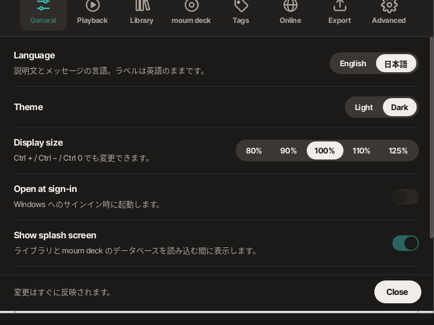
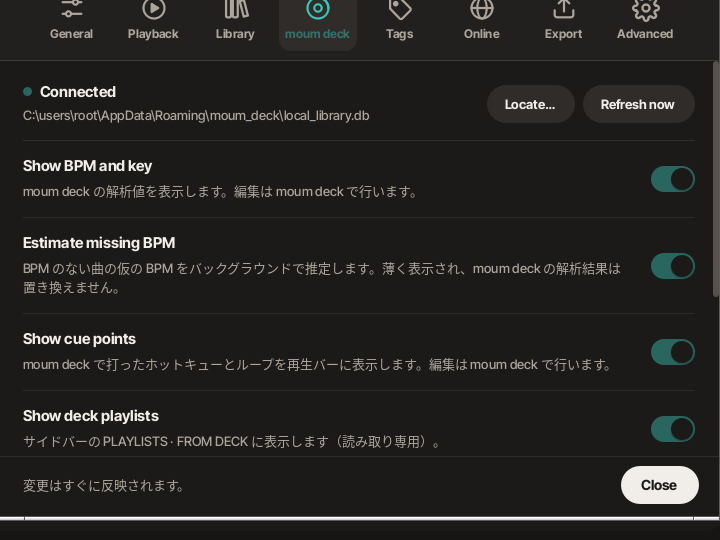

# moum player — 書き出しと設定

[🏠 ホーム](../README.md) ｜ [▶️ 基本の使い方](basics.md) ｜ [🎵 曲の管理](library.md) ｜ **💾 書き出しと設定** ｜ [❓ 困ったとき](faq.md)

---

## 10. 書き出し（Export）

**File › Export library…**（Ctrl E）を開きます。上の **FORMAT** で、書き出し先の種類を選びます。

### 10-1. moum deck USB

USB メモリや外付けドライブに、曲・カバー画像・moum deck 用のライブラリ（ドライブの一番上の `.moum_deck` フォルダー）を書き出します。
moum deck は、USB のライブラリを、**ドライブの一番上のフォルダー**からだけ探します。

| 項目 | 内容 |
|---|---|
| DESTINATION | 書き出し先のドライブ、または **Choose folder…** で選ぶフォルダー |
| PURPOSE | **DJ USB**（曲・カバー・プレイリスト・解析を moum deck の並びで）/ **Backup**（ライブラリのデータベースと設定も含めて、そのままコピー）/ **Another PC**（フォルダーの並びと、moum player のデータベースと設定のコピー。中のパスは元の PC のもので、書き換えません） |
| INCLUDE | Music files / Artwork / Playlists / moum deck analysis / Library edits / Library database & settings |
| SONGS | Whole library / Playlists only / Sources / Selected songs |
| SYNC | **Add and update**（何も消さない）/ **Mirror**（以前この書き出しで入れて、今は選ばれていない曲を消す。ほかのファイルは残る） |
| FOLDERS | moum deck layout / Same as library / Artist › Album |

- 右の SUMMARY に、New（新規）/ Changed（変更）/ Unchanged（変更なし）の数、コピーするサイズ、空き容量が出ます。
  **新しい・変わったファイルだけ**をコピーするので、何度でも同じドライブに書き出し直せます。
- 空き容量が足りないときや、ドライブの一番上ではないフォルダーを選んだときは、警告が出ます（その場合 moum deck は USB のライブラリを見つけません）。
- 書き出し中も、再生は続けられます。**ドライブを抜かないでください。** Cancel export で止められます。
- exFAT のドライブは、Windows と Mac の moum deck で使えます。

### 10-2. moum deck on this PC

moum player で編集した内容を、**この PC の moum deck のライブラリ**に書き込みます。moum deck で、同じ情報が見えるようになります。

1. 先に **moum deck を終了**します。起動中は、何も書き込まれません。
2. **FORMAT** で「moum deck on this PC」を選びます。変更される曲と項目の**プレビュー**が出ます。
3. 確認して実行します。**書き込む前に、データベースのバックアップ**（zip ファイル）を、moum deck のデータベースと同じ場所に作ります（新しい 5 つを残します）。
4. 次に moum deck を起動すると、新しい値が読まれます。

- 書き込む項目：タイトル・アーティスト・アルバム・アルバムアーティスト・ジャンル・年・トラック番号・レーベル・カタログ番号・追加日。
  （古い版の moum deck では、アルバムアーティスト・レーベル・カタログ番号などが書き込めません。）
- **BPM・キー・キュー・ループ・グリッド・プレイリストは変わりません。**
- moum player で、ファイルを移動（再リンクや整理）した曲は、moum deck でも新しいパスに付け替えられます。キューやプレイリストは、そのまま残ります。
  移動先に、すでに別の曲がある場合は、付け替えず、一覧に出ます。
- 書き込みは、1 回の処理で行います。途中で止まったときは、変更されません。
- 戻したいときは、作られたバックアップを使います。

### 10-3. rekordbox XML

rekordbox 用の XML ファイルを 1 つ書き出します。曲のファイルはコピーせず、今の場所を指します。キューとループは、moum deck の解析から作られます。

- rekordbox 側：Preferences › Advanced › Database › rekordbox xml でこのファイルを選び、ツリーの「rekordbox xml」から、曲やプレイリストを取り込みます。

### 10-4. Traktor NML

Traktor 用のコレクションファイル（`.nml`）を 1 つ書き出します。曲のファイルはコピーしません。

- Traktor 側：Browser Tree の「Track Collection」を右クリック › Import Another Collection で、このファイルを選びます。Traktor 自身のコレクションは、置き換わりません。

rekordbox XML と Traktor NML では、書き出し先のファイルを選びます。もう一度書き出すと、その時点のライブラリで、ファイルが置き換わります。
どちらも、他のソフトのデータは変更しません。

---

## 11. Settings（設定）

**File › Settings…**（Ctrl ,）で、別ウィンドウの設定が開きます。上のタブで切り替えます。
**変更はすぐ反映・保存されます**（OK ボタンはありません）。閉じるのは Close か Esc です。

| General タブ | moum deck タブ |
|---|---|
|  |  |

| タブ | 内容 |
|---|---|
| General | Language / Theme（Light・Dark）/ Display size / Show splash screen。（Open at sign-in、Close button の「Keep playing in tray」は、まだ使えません） |
| Playback | Output device / Gapless playback / Resume where I left off。（Exclusive mode、Crossfade、Volume levelling は、まだ使えません） |
| Library | Library folder（Change… / Open）/ Folder layout / Add music（Add folder… / Add files…）/ iTunes / Music library（Import…）/ Songs outside the library folder / moum deck folders（参考表示）/ Rescan now / File types / ffmpeg（Install… / Locate…）。（Watch folders は、まだ使えません） |
| moum deck | moum deck のデータベースの状態（Locate deck DB / Refresh now）/ Show BPM and key / Estimate missing BPM / Show cue points / Show deck playlists / Refresh when moum deck closes / Add imported folders to moum deck（Retry now） |
| Tags | Garbled tags / Artist names / Organise files / Duplicates / Missing files / Check the library regularly（Check now）/ Missing tags / Write changes into the music files / Write tags to files |
| Online | Look up covers and tags online / Covers。（Check for updates は、まだ使えません） |
| Export | Export now…。（そのほかの項目は準備中です） |
| Advanced | Keyboard（ショートカットの一覧）/ Licences（Third-party notices） |

「まだ使えません」と書いた項目は、画面には出ますが、押せません（今のバージョンでは未対応）。

---

## 12. データの場所とバックアップ

### moum player のデータ

`%APPDATA%\moum_player\` に保存されます。インストール先には書きません。アップデートや再インストールでは消えません。

| ファイル | 内容 |
|---|---|
| `settings.json` | 設定 |
| `player.db` | moum player のデータ（編集内容、購入元・購入日・価格、取り込んだ曲、再生位置など） |
| `tag_write_log.jsonl` | ファイルのタグへ書き込む前の値の記録（Undo tag writes で使います） |
| `startup_log.jsonl` | 起動時間の記録（直近 30 回分。§14） |
| `ffmpeg\` | moum player が入れた ffmpeg（入れた場合のみ） |

- `player.db` が壊れていたときは、新しいものを作り直して起動します。古いファイルは、別の名前で残します（画面にもお知らせが出ます）。
- `player.db` が新しい版の moum player で保存されたものだったときは、表示だけで、変更は保存できません。moum player を新しくしてください。

### 曲のファイル

取り込んだ曲は、Library folder（初期値はミュージックフォルダー内の `moum player`）に入っています。
moum deck のライブラリの曲は、moum deck が読む元のフォルダーにあります。

### バックアップの取り方

- **moum player を終了してから**、`%APPDATA%\moum_player\` フォルダーを、フォルダーごとコピーします。
- 曲のファイルは、別にコピーしておいてください。
- 曲のファイルとデータをまとめて残したいときは、**Export › moum deck USB** の **Backup**（Library database & settings を含む）が使えます（§10-1）。
- moum deck のデータ（`%APPDATA%\moum_deck\`）は moum deck 側のデータです。moum deck を終了してから、フォルダーごとコピーしてください。
- **Export › moum deck on this PC** は、実行のたびに、moum deck のデータベースのバックアップ（zip）を作ります（§10-2）。

---

## 13. キーボードショートカット

アプリの **Help › Keyboard shortcuts**（F1）と、同じ内容です。

| キー | 動作 |
|---|---|
| Space | 再生 / 一時停止 |
| ← / → | 5 秒戻る / 5 秒進む |
| ↑ / ↓ | 曲の選択 |
| Enter | 選んだ曲を再生 |
| Ctrl F | 検索 |
| Ctrl I | Edit properties（曲の編集） |
| Ctrl E | Export library（書き出し） |
| Ctrl , | Settings |
| Ctrl M | ミニプレイヤー |
| Ctrl 1〜4 | Songs / Albums / Artists / Playlists |
| Ctrl Q | 再生キュー（Up next）の表示 |
| Ctrl D | ダークモード |
| Ctrl + / Ctrl − / Ctrl 0 | 表示サイズの拡大 / 縮小 / 100% |
| Ctrl → / Ctrl ← | 次の曲 / 前の曲 |
| Ctrl S | シャッフル |
| Ctrl ↑ / Ctrl ↓ | 音量 |
| F1 | Keyboard shortcuts |
| Alt / F10 | メニューバー（Alt + F / E / V / C / H で、各メニュー） |

メニューにだけ出るショートカット：Ctrl O（Add folder…）、Ctrl A（Select all）、Ctrl C（Copy）、Ctrl R（Refresh library）、Del（Remove from library）。
