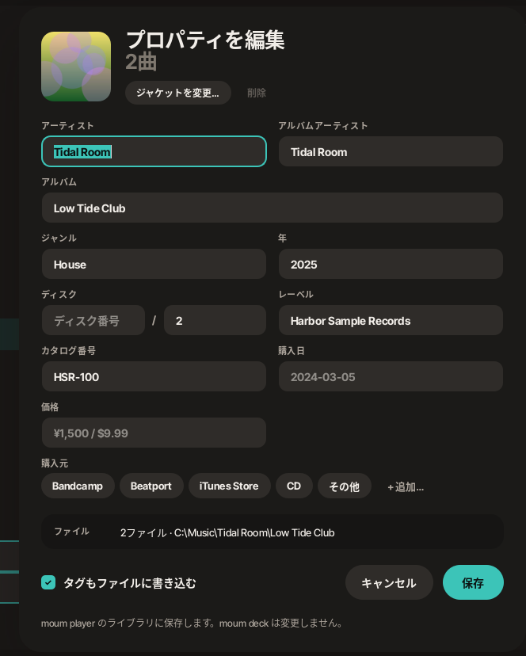
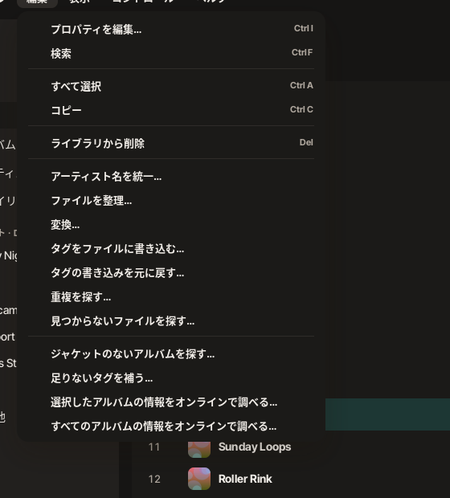

# moum player — 曲の管理

[🏠 ホーム](../README.md) ｜ [▶️ 基本の使い方](basics.md) ｜ **🎵 曲の管理** ｜ [💿 CD・変換・オンライン](cd-convert-online.md) ｜ [💾 書き出しと設定](export-settings.md) ｜ [❓ 困ったとき](faq.md)

---

## 5. 曲を取り込む

### 5-1. フォルダー・ファイルを取り込む

1. **ファイル › フォルダーを追加…**（Ctrl O）でフォルダーを、**ファイル › ファイルを追加…** でファイルを選びます。ウィンドウへのドラッグ＆ドロップでも始められます。
2. 曲を調べる画面になります（再生は続けられます）。調べ終わると、確認の画面が出ます。
3. 確認の画面で、次を決めて **取り込み** を押します。

| 項目 | 内容 |
|---|---|
| 保存先 (ライブラリフォルダー) | 曲のコピー先。初期値は、ミュージックフォルダー内の `moum player` です。**変更…** で変えられます |
| フォルダー構成 | コピー先でのファイル名の付け方。「アーティスト / アルバム / 01 タイトル」「アーティスト / アルバム / タイトル」「アーティスト - アルバム / 01 タイトル」から選びます |
| 重複 | 重複していた曲を **スキップ**（取り込まない）か **取り込み** にします（重複の見つけ方は下記） |
| 文字化けしたタグを修復 | 文字化けして見えるタグを直して取り込みます（直した内容は moum player に保存され、ファイルは変えません） |
| moum deck に追加 | 取り込み先のフォルダーを、moum deck の取り込み元に追加します（§1） |

- **取り込んだ曲は、いつも「ライブラリフォルダー」にコピーされます。元のファイルは変更しません。**
- 取り込めなかったファイル（ffmpeg がない M4A、取り込まない種類、読めないファイル）は、確認の画面の「取り込まないもの」に出ます。
- 重複は、次の 3つで見つけます：すでにライブラリにある / 内容が同一 / タイトル・アーティスト・アルバム・長さが同じ。
- 途中でキャンセルしても、取り込み済みの曲は残ります（途中のコピーは消えます）。
- 取り込む種類は **設定 › ライブラリ › ファイル形式** で選べます（FLAC / MP3 / M4A / WAV / AIFF。M4A は ffmpeg が必要。OGG は選べません）。
- moum deck が起動中でデータベースが使えないときは、フォルダーの登録が「待ち」になり、あとで自動で再試行します。
  **設定 › moum deck** の **今すぐ再試行** で、すぐにやり直せます。

### 5-2. iTunes / Music ライブラリを取り込む

1. iTunes（または Music）で、ライブラリを書き出して `Library.xml` を作ります（iTunes: ファイル › ライブラリ › ライブラリを書き出す…）。
2. **ファイル › iTunes ライブラリを取り込む…** で、その XML ファイルを選びます。
3. あとは §5-1 と同じ確認の画面です。曲のファイルが見つからないものは、「iTunes ライブラリのうちファイルが見つからない曲」に数が出ます。

XML ファイルは読むだけで、変更しません。曲は、ライブラリフォルダーにコピーされます。

### 5-3. 以前の「その場のまま」の曲

以前の版で、コピーせずに追加した曲は、元の場所のまま再生されます。
**設定 › ライブラリ › ライブラリフォルダー外の曲** に、そのフォルダーが出ます。
フォルダーの右の「削除」で、そのフォルダーの曲を moum player から外せます（**ファイルは消えません**）。

### 5-4. ライブラリの読み直し

- **設定 › ライブラリ › 今すぐ再スキャン**：ライブラリの曲を、もう一度調べます。
- **Ctrl R**（ライブラリを更新）：moum deck のデータを読み直します。
- moum deck が更新されたときは、数秒以内に自動で読み直されます（**設定 › moum deck › moum deck を閉じたら更新**）。

---

## 8. 曲の情報を編集する・ファイルのタグに書き込む

### 8-1. 曲の情報を編集する

曲を選んで **編集 › プロパティを編集…**（Ctrl I）、または右クリックの **プロパティを編集…**。
アルバムごとは **アルバム情報を編集…**、複数の曲を選んだときは、共通の項目をまとめて変えられます
（曲によって違う項目は「複数の値」と出て、空のままなら変わりません）。

| 項目 | 内容 |
|---|---|
| タイトル / アーティスト / アルバムアーティスト / アルバム / ジャンル / トラック番号 / ディスク / 年 | 基本の情報。「ディスク」には、番号と総数を入れます（「1 / 2」）。アルバム全体の編集には、ディスクの欄はありません |
| レーベル / カタログ番号 | レーベルとカタログ番号 |
| 購入日 / 価格 | 購入日（例：2024-03-05）と価格（例：¥1,500 / $9.99）。**moum player の中だけに保存され、ファイルにも moum deck にも書きません** |
| 購入元 | 購入元。初めからある 5つと、自分で作ったものから選びます（もう一度押すと解除）。「+ 追加…」で、自分の購入元を足せます（§4-9） |

- アルバムの **ジャケットを変更…** で、ジャケット（JPEG / PNG）を差し替えられます。**削除** で、ファイルのジャケットに戻します。
- BPM とキーは moum deck の解析結果で、ここでは変えられません。
- 文字化けして見えるタグがあると、修復案が出ます。**候補を使う** で入力欄に入れられます。
- 編集内容は、まず moum player のデータ（`player.db`）に保存されます。**moum deck は変わりません。**

### 8-2. ファイルのタグに書き込む（初期設定でオン）

**この機能は、初期設定でオンです。** 編集画面の「タグもファイルに書き込む」にチェックが入った状態で始まり、保存を押すと、
音楽ファイルの中のタグ（タイトル・アーティスト・アルバム・ジャンル・年・トラック番号・ディスク番号・ジャケットなど）も書き換えます。
こうすると、iTunes など他のプレーヤーでも、同じ情報が見えます。

- **ファイルそのものを書き換えます。** 書き換えたくないときは、編集画面で「タグもファイルに書き込む」のチェックを外します。
  チェックの状態は覚えられます。**設定 › タグ › 変更内容を音楽ファイルに書き込む** でも、オン・オフできます。
- 書き込む前の古い値は、`tag_write_log.jsonl`（moum player のデータフォルダー内）に残ります。
  元に戻したいときは、**編集 › タグの書き込みを元に戻す…**（§8-4）。
- moum deck のデータベースは、このとき変わりません。

### 8-3. まとめて書き込む：編集 › タグをファイルに書き込む…

moum player が表示している内容（編集を含む）と、ファイルのタグが**違う曲だけ**を調べて、一覧にします。

1. **編集 › タグをファイルに書き込む…** を開く（設定 › タグ › タグをファイルに書き込む の **プレビュー…** でも同じ）。
2. 違いのある曲と、変わる項目（例：`タイトル: 旧 → 新`）が出ます。書き込まない曲は、チェックを外します。
3. **書き込む** を押すと、書き込みが始まります。途中で止めることもできます。
4. 結果（書き込んだ・すでに同じ・失敗）が出ます。

書き込む項目は、タイトル / アーティスト / アルバムアーティスト / アルバム / ジャンル / 年 / トラック番号 / ディスク番号（総数も） / BPM / キー / レーベル / カタログ番号 / コンピレーション / ジャケットです。
**購入日・価格・購入元は、ファイルに書きません。**
書き込めるファイルは、MP3 / AIFF / WAV / FLAC / M4A などです。

moum deck の曲にタグを書き込んだときは、moum deck に「このファイルのタグを読み直して」という依頼を残します（moum deck が起動中でも行います）。
moum deck は、手が空いたときに、タグ由来の項目だけを読み直します（BPM・キー・キュー・ループ・グリッドは変わりません）。
古い版の moum deck では、この依頼は残されません。

### 8-4. 元に戻す：編集 › タグの書き込みを元に戻す…

1. **編集 › タグの書き込みを元に戻す…** を開くと、最近の書き込みが、新しい順に並びます（記録は約 180日分）。
2. 戻したい回を選ぶと、何が戻るかのプレビューが出ます。
3. **元に戻す** で戻します。

- ファイルのタグが、moum player が書いたときのままの曲だけが戻ります。**その後に変更された曲や、移動・削除された曲は、スキップされます。**
- その書き込みで変わった moum player 側の値（編集内容・差し替えたジャケット）も、あなたがその後に変えていなければ、一緒に戻ります。

---

## 9. 整理ツール

いずれも、**編集** メニューか **設定 › タグ** から開けます。実行の前にプレビューが出ます。

| ツール | 開く場所 | 内容 |
|---|---|---|
| 重複 | 編集 › 重複を探す… | ライブラリに何度も入っている曲を見つけて、余分なコピーを隠します。「非表示にした曲のファイルをごみ箱にも移す」を選ぶと、ファイルもごみ箱へ移せます（moum player に追加した曲だけ。moum deck が知っているファイルは削除しません） |
| 見つからないファイル | 編集 › 見つからないファイルを探す… | 移動・名前変更でファイルが見つからなくなった曲の、新しい場所を探して付け替えます（場所を付け直す） |
| アーティスト名の統一 | 編集 › アーティスト名を統一… | 大文字小文字・全角文字・スペース・「The」だけが違うアーティスト名を、1つの書き方にそろえます |
| ファイルの整理 | 編集 › ファイルを整理… | moum player が取り込んだ曲を、タグに合わせて、ライブラリフォルダーの中で移動します（フォルダーの付け方は 設定 › ライブラリ › フォルダー構成）。空になったフォルダーは消えます |
| 文字化けしたタグの修復 | 右クリック › 文字化けを直す…、設定 › タグ › 文字化けしたタグ | 文字コードの取り違いで化けた日本語のタグを探して、直します |
| 欠けているタグの補完 | 編集 › 足りないタグを補う… | タグが空の曲に、ファイル名などから、タイトル・アーティスト・アルバム・年・トラック番号の案を出します |

- アーティスト名の統一と、ファイルの整理は、実行したあとに「元に戻す」が出ます。
- 移動したファイルは、上書きされません。**moum deck の曲は、「ファイルを整理」では移動しません。**
- アーティスト名の統一では、「名前も音楽ファイルのタグに書き込む」で、ファイルのタグにも書き込めます（moum player が取り込んだ曲が対象です）。
- これらの変更は moum player に保存され、moum deck は変わりません。moum deck にも反映したいときは、§12-2 を使います。

---

## 11. ライブラリの健康診断

起動の少しあとと、その後は 1日に 1回、ライブラリを調べます。**何も変更しません。**
サイドバーの下に、結果が **ライブラリ · 問題なし** または **ライブラリ · 確認 3件** のように出ます。クリックすると、一覧が開きます。

調べる項目：見つからないファイル / 重複 / 文字化けしたタグ / 表記ゆれのアーティスト名 / ジャケットのないアルバム。
項目ごとの **開く…** で、対応する整理ツール（§9、§10）が開きます。**今すぐ確認** で、すぐに調べ直せます。

**設定 › タグ › ライブラリを定期的に確認** で、定期チェックをオフにできます。

---

moum player v1.1.0 の説明です。スクリーンショットに写っている曲は撮影用のサンプルです。
